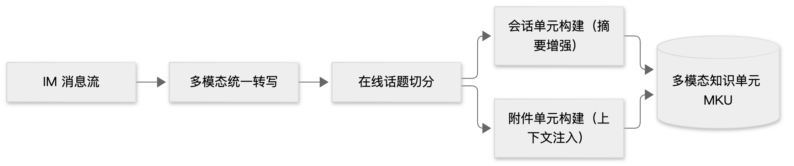
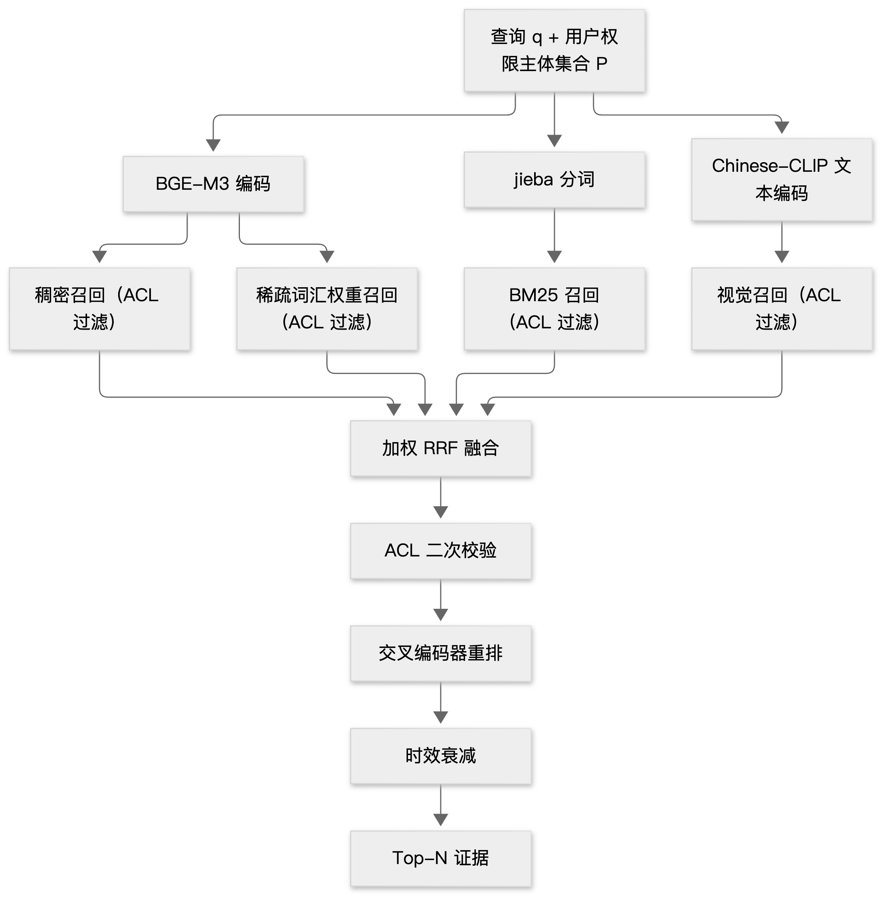
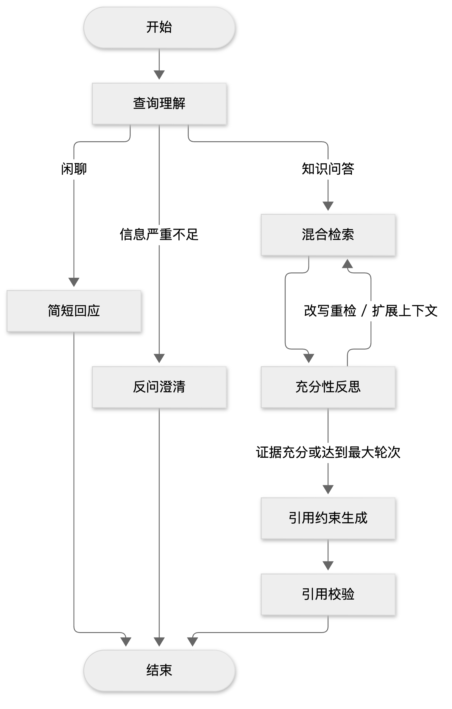
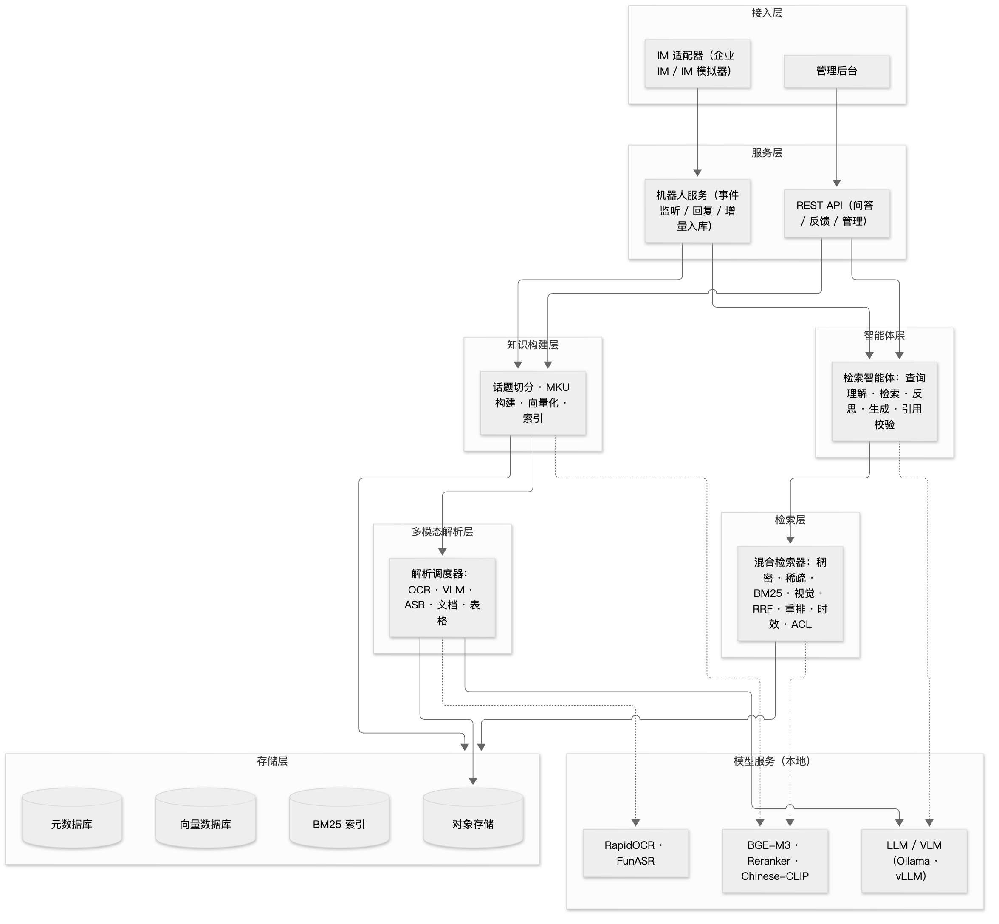
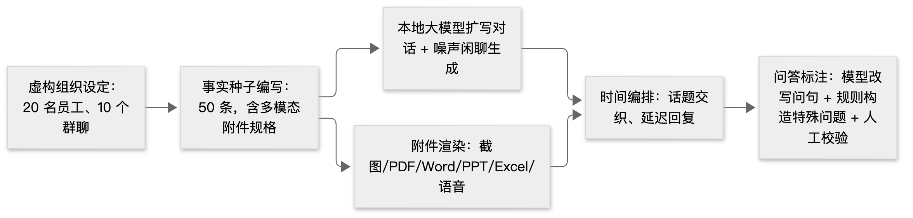

# 一、选题背景与研究意义

## 1.1 选题背景

随着企业数字化办公的深化，以企业微信、钉钉、飞书和 Slack 为代表的企业即时通讯（Instant Messaging，IM）平台已超越单纯的消息传输工具，演变为组织协同、问题排查、方案讨论与决策沉淀的核心阵地。研发团队在群聊中定位生产故障、评审技术架构，产品团队实时确认需求变更与排期，运维与职能部门则通过群组同步应急手册与管理制度。组织知识创造理论指出，企业隐性知识需经过持续外化与结构化才能沉淀为可复用资产[@A1]；企业社交媒体研究亦表明，IM 通信记录天然具备“可见性”与“持久性”，是极高密度的组织知识矿藏[@A4]。

然而，企业 IM 中的知识在工程实践中普遍面临“**聊天即遗忘**”的困境，难以直接检索和复用：

（1）**消息碎片化与多话题交织**：一次完整的问题排查往往跨数十条短消息并穿插闲聊（如“收到”“+1”“下午开会”），多个讨论线程在时间轴上交织并存，单条消息脱离上下文后几乎无法被正确理解。

（2）**多模态信息高度分散**：报错堆栈以截图发送、接口规范与制度文档以 PDF/Word/PPT 传递、压测与排期数据以 Excel 表格分享、值班交接使用语音消息。传统企业搜索主要基于文本倒排索引，对截图、附件图表及语音中的核心信息几乎无能为力[@A3]。

（3）**访问权限边界严格与数据保密诉求强烈**：企业群聊存在严格的成员隔离（如管理层群聊、核心项目组与普通全员群），检索阶段一旦发生跨群泄露将引发严重合规事故[@I2][@I3]；同时企业聊天内容涉及商业机密与员工隐私，无法上传至公有云大模型 API，必须在企业内网乃至受限本地算力环境中实现私有化部署。

近年来，大语言模型（LLM）[@B4][@B6] 与检索增强生成（RAG）[@C1][@C4] 为企业知识问答开辟了新路径，视觉语言模型（VLM）[@E6] 与非自回归中文语音识别模型（ASR）[@E16] 的发展也使多模态内容自动理解成为可能；结合具备检索规划与自我反思能力的智能体（Agent）技术[@F1][@F3][@C12]，为破解企业 IM 知识“沉睡”难题提供了可行基础。

## 1.2 研究意义

面向企业即时通讯的多模态知识检索系统并非通用文档 RAG 的简单迁移。从理论视角看，本选题围绕非结构化交织对话流的话题解缠与知识单元表示、低选择率群组权限下的多路混合检索融合机理、以及小参数受限算力下状态图驱动的可溯源智能体规划机制展开探索，有助于弥补现有 RAG 与 Agentic RAG 研究长期聚焦静态公开文本语料而忽视 IM 场景（碎片、多模态、强权限、时效演化）的不足。从工程与专业应用视角看，本课题拟构建一套平台解耦、全组件开源可本地运行、答案逐句可溯源的原型系统，帮助员工快速检索历史故障根因、接口约定与最新制度标准，显著降低新员工上手成本与跨部门沟通损耗，并为类似组织级协同软件的智能化升级提供工程范本。

---

# 二、国内外研究现状及存在问题

## 2.1 企业知识管理与会话解缠研究现状

企业知识管理系统围绕知识的创造、存储检索、转移与应用展开[@A2]。早期企业搜索研究已经指出，与互联网网页搜索相比，企业搜索需直面数据源高度异构、缺乏超链接拓扑、必须按用户角色执行“安全裁剪”（Security Trimming）以及公开评测数据集稀缺等独特难题[@A3]。在即时通讯协作挖掘方面，Chatterjee 等人构建并公开了面向软件工程的 Slack 群聊解缠数据集[@A5]；工业界 NVIDIA 团队系统总结了构建企业级 RAG 聊天机器人的工程实践，强调数据新鲜度维护、文档级权限控制、自动化评测与安全护栏的重要性[@A6]。

在会话线程拆分（会话解缠，Conversation Disentanglement）领域，Elsner 与 Charniak 提出了首个 IRC 聊天解缠语料及基于图划分的聚类方法[@G1]；Kummerfeld 等人发布了大规模 Ubuntu IRC 标注基准，确立了 1-1 重叠率等核心评价指标[@G2]；Xing 与 Carenini 则结合语句对连贯性打分改进无监督对话话题切分[@G3]。在上下文问题补全方面，CANARD 数据集研究了对多轮对话中带指代问题进行重写的方法[@G4]。但现有工作多将话题切分或查询改写作为孤立任务研究，尚未与多模态知识单元索引及权限检索协同设计。

## 2.2 检索增强生成与多路混合检索研究现状

RAG 范式通过检索外部知识库注入上下文，有效抑制大模型的事实性与忠实性幻觉[@C1][@H4]。Gao 等人将其划分为朴素 RAG、高级 RAG 与模块化 RAG 三个演进阶段[@C4][@C5]。在检索增强方面，DPR 开创了双塔稠密语义检索[@C3]，BM25 则凭借精确词项逆文档频率权重在专有名词与错误码匹配上不可替代[@D1]；C-Pack 与 BGE-M3 进一步实现了中英文多粒度嵌入，并在单次前向推理中同时输出稠密向量与稀疏词汇权重[@D3][@D4]。对于多路检索排序合并，倒数排名融合（RRF）无需分数校准即可实现稳健融合[@D5]，配合交叉编码器（Cross-Encoder）精排能够大幅提升首位精度[@D6]。在系统索引与数据治理方面，RAPTOR[@C9] 和 GraphRAG[@C10] 探索了层次摘要与社区摘要索引，但对动态增量聊天的重构建开销较大；Milvus 等现代向量数据库提供了 HNSW[@D7] 与标量过滤下推能力，使向量检索内原生嵌入访问控制成为可能[@D8]。

## 2.3 多模态信息检索研究现状

传统多模态检索依赖图文对比学习（CLIP / Chinese-CLIP）建立跨模态共享语义空间[@E1][@E2]，而在文档与截图检索领域主要沿两条路线演化：一是以 OCR（PP-OCR）[@E13]、版面解析（LayoutLMv3、MinerU）[@E12][@E14] 及语音识别（Whisper、Paraformer/FunASR）[@E15][@E16][@E17] 为代表的“**解析转写路线**”，配合 Qwen2-VL / Qwen2.5-VL 等视觉语言模型理解图表语义[@E5][@E6]；二是以 ColPali[@E7]、VisRAG[@E8] 和 M3DocRAG[@E9] 为代表的“**端到端页面视觉多向量路线**”，直接编码文档整页图像以避免文本抽取损耗[@E10]。然而，端到端视觉多向量索引显存消耗庞大，难以在无独立 GPU 的轻量私有化服务器上落地，且不适用于文本闲聊与 WAV 语音交织的 IM 会话场景。

## 2.4 大模型智能体与可信访问控制研究现状

思维链（CoT）[@F4] 与 ReAct 框架[@F1] 催生了自主检索规划智能体（Agentic RAG）[@F5][@C12]：Rewrite-Retrieve-Read[@G5] 与 HyDE[@C8] 优化查询表达，Self-RAG[@C6]、CRAG[@C7] 与 Adaptive-RAG[@C11] 让模型评估证据充分性并触发纠错重检，Search-o1[@F7] 和 Search-R1[@F8] 进一步利用推理模型与强化学习提升多步检索能力[@B7]。同时，针对大模型在长上下文中间位置遗忘的“Lost in the Middle”效应[@C13] 以及引用溯源评测基准 ALCE[@H5]，亟需精排后置顺序优化与句级引用验证机制。安全方面，RBAC 权限模型[@I1] 与近期针对 RAG 隐私泄露的研究均指出，企业级 AI 必须在检索与生成各环节确定性地执行参与者感知访问控制（Participant-Aware Access Control）[@I2][@I3]。

## 2.5 现有研究的不足

综上，现有研究应用于企业即时通讯知识检索仍面临四点明显缺口：
1. **缺乏面向 IM 交织消息流的知识单元建模**：固定长度文档分块极易截断上下文或混杂话题，附件脱离聊天语境则丧失语义锚点；
2. **多模态覆盖、轻量算力与精确词项难以兼顾**：端到端视觉多向量门槛过高，纯 OCR 无法理解架构图/监控曲线语义，单路稠密向量易漏检错误码、IP 等字符；
3. **缺少贯穿检索、重排与展示全链路的权限隔离机制**：事后过滤在低选择率场景下极易导致召回空洞或配置疏漏泄露；
4. **本地小参数模型下的可控规划与伪引用控制不足**：开放域自由 ReAct 循环易发散，且模型生成引用编号常与实际证据支撑关系不符。

---

# 三、研究目标与主要研究内容

## 3.1 研究目标

面向企业内网数据不出域、算力受限（无独立 GPU 的 16 GB 单机即可运行原型，并可平滑扩展至 vLLM[@I4] 生产集群）的现实约束，本课题拟设计并实现一套**面向企业即时通讯的多模态知识检索 Agent 系统**，实现非结构化多模态群聊知识的自动化沉淀、权限安全的精准召回、以及多步可控且逐句可溯源的智能问答。

## 3.2 主要研究内容

课题围绕以下四个紧密衔接的模块展开研究：

（1）**面向 IM 会话的多模态知识单元（MKU）构建与在线话题切分**：设计涵盖文本、截图、PDF/Word/PPT 文档、Excel 表格与 WAV 语音的统一解析转写策略，研究基于“语义相似度 + 回复/@提及结构 + 时间衰减”的在线话题解缠算法，构建摘要增强会话单元与上下文注入附件单元，并支持基于同步水位的增量更新。

（2）**权限感知的多路混合检索方法**：融合 BGE-M3 稠密向量、BGE-M3 稀疏词汇权重、BM25 词法与 Chinese-CLIP 视觉向量四路召回信号，设计带模态意图调权的加权 RRF 融合、交叉编码器精排与时效衰减排序策略；将群成员 ACL 主体集合下推至向量库底层标量过滤，配合应用层二次校验实现纵深防御。

（3）**基于状态图的检索规划与可溯源问答智能体**：利用可控状态图编排“查询理解（指代消解/约束解析/子问题拆分）—混合检索—充分性自反思—引用约束生成—句证交叉编码校验”闭环，设计低置信度相关性门限防幻觉机制，并输出可点击跳转原始消息的来源卡片。

（4）**系统原型实现、模拟评测基准构建与实验评估**：定义平台无关的 `IMAdapter` 接口与自研 IM 模拟器、FastAPI 后端及 Vue 3 前端界面；在严格不触碰企业真实涉密数据的前提下，构造包含多模态隐藏事实与权限边界的模拟企业基准 **SimEIM**，辅以公开中文检索基准 **C-MTEB T2Retrieval** 开展对比实验、消融实验以及系统功能与并发性能验收。

---

# 四、拟解决的关键问题与技术方案

本课题重点攻克以下三项核心技术问题：

## 4.1 关键技术一：IM 多模态统一转写与融合多线索的在线话题切分

针对截图文字精确度与版面语义兼顾问题，拟采用“OCR 精确提取 + VLM 语义描述”的互补表示策略：

$$T_{\mathrm{img}}=\left[\,\text{【图片描述】}:\ \mathrm{VLM}(I, p_{\mathrm{cap}})\,;\ \text{【图中文字】}:\ \mathrm{OCR}(I)\,\right] \tag{4.1}$$

表格按固定行数分块并重复携带表名与表头，逐行序列化为“列名: 值”键值对；文档按“段落—句子”边界保留重叠并注入文件名与页码/章节前缀；语音采用独立子进程运行 FunASR Paraformer + VAD + 标点恢复，避免音视频运行时与向量库 gRPC 线程及 Metal 计算上下文产生冲突。

针对群聊多话题交织问题，拟将话题切分建模为消息归属活跃话题的在线决策，计算当前消息 $m$ 与活跃话题 $T$ 的综合亲和度：

$$S(m,T)=\alpha\cdot \mathrm{Sim}(m,T)+\beta\cdot \mathrm{Rel}(m,T)+\gamma\cdot \exp\!\left(-\frac{\Delta t(m,T)}{\tau}\right) \tag{4.2}$$

其中语义项 $\mathrm{Sim}(m,T)$ 为消息向量与话题滑动质心向量的余弦相似度，结构项 $\mathrm{Rel}(m,T)$ 刻画回复关系、@ 提及同源及短时间同人连发信号，时间项以尺度 $\tau$ 刻画时间衰减；对“收到”“+1”等低信息量消息跳过质心更新并优先依据结构信号归属。基于切分结果生成两类知识单元 $\mathrm{MKU}$，整体构建流程如图 4.1 所示。

图 4.1 多模态知识单元（MKU）构建流程

为缩短口语群聊与书面提问间的语义鸿沟，3 条以上消息的话题将调用大模型生成结构化标题、摘要与关键词作为会话单元前缀；每个附件分块则单独构建附件单元，在内容前注入来源会话、发送人、时间与所属话题上下文头。增量入库仅回溯最近活跃窗口（如 6 小时）重切受影响话题并幂等替换对应 MKU，确保计算开销可控。

## 4.2 关键技术二：ACL 过滤下推的权限感知多路混合检索

如图 4.2 所示，检索器同时调动四路信号：BGE-M3 稠密向量（语义对齐）、BGE-M3 稀疏词汇向量与 jieba-BM25（专有名词、错误码与版本精确匹配）、Chinese-CLIP 视觉向量（跨模态图文互补，设相似度下限阈值避免噪声图片干扰）。

图 4.2 权限感知的多路混合检索流程

多路结果经加权 RRF（默认权重稠密 $1.0$、稀疏与 BM25 各 $0.7$、视觉 $0.3$，识别“找图”意图时视觉路提权至 $1.0$）合并后，送入交叉编码器 `bge-reranker-v2-m3` 精排，并对相关性相近的结果施加时效衰减调节，使最新规则优先呈现：

$$s(q,d)=(1-\mu)\,s_{\mathrm{rr}}(q,d)+\mu\cdot 0.5^{\,\Delta_d/h} \tag{4.3}$$

权限方面，查询时实时解析用户所属个人、群会话与部门主体集合 $P(u)$，并把 `array_contains_any(acl, P(u))` 下推为向量库标量前置过滤条件与 BM25 倒排过滤条件，融合后再次比对 `MKU.acl` 完成二次校验，结合前端来源跳转权限拦截形成纵深防御，兼顾低选择率下的高召回与零越权风险。

## 4.3 关键技术三：受控状态图驱动的检索规划与句级引用校验

针对自由 ReAct 循环在本地 8B 量化模型上易陷入无效工具循环、产生伪引用的问题，拟基于 LangGraph 构建五节点可控状态图（如图 4.3 所示）：

图 4.3 检索智能体状态图

（1）**查询理解**：结合最近 8 条会话历史消解指代、抽取时间/会话/模态过滤约束并拆分 1–3 个子查询，同时支持对“闲聊”直接简短回应，对信息严重缺失触发“反问澄清”；对结构化小任务关闭大模型思考模式（`reasoning_effort="none"`）以大幅降低单轮推理延迟。

（2）**充分性反思**：评估已召回 Top 证据能否完整回答问题，不足时触发带上限次数（最多 3 轮）的改写重检或同话题上下文扩展；将关键证据重排至上下文头部以缓解位置遗忘问题。

（3）**相关性门限与引用校验**：生成前过滤低于门限（`0.05`）的弱相关证据，零命中时触发模板安全拒答以阻断跨主题“张冠李戴”；生成后按句切分回答，批量调用交叉编码器计算“句子—被引证据”支撑度，剔除越界及低支撑引用，并将最终引用组装为包含会话名、发送人、时间与附件信息的来源卡片。

---

# 五、系统总体架构与实验评测方案

## 5.1 系统总体架构与部署方案

系统采用七层解耦架构（如图 5.1 所示），自下而上依次为存储层（SQLite、Milvus Lite 向量库、内存 BM25、本地对象存储）、多模态解析层、知识构建层、混合检索层、智能体层、服务层（机器人事件服务与 FastAPI REST 接口）及接入层（`IMAdapter` 抽象接口与 Vue 3 前端）。

图 5.1 系统总体架构

系统所有计算组件均采用开源模型，支持单机原型（Apple Silicon 16 GB 统一内存环境，利用 Ollama 分别调度 `Qwen3-8B` Q4 量化语言模型与 `Qwen2.5-VL-3B` 视觉语言模型，利用 MPS FP16 半精度加速 BGE-M3 与重排器推理）以及企业生产集群平滑切换，具体选型对照如表 5.1 所示。

表 5.1 单机原型与企业生产部署方案对照

| 核心组件 | 单机原型（开发与评测） | 企业内网生产部署 |
|---|---|---|
| 大模型推理 | Ollama：`Qwen3-8B`（Q4_K_M）、`Qwen2.5-VL-3B` | vLLM 连续批处理服务：`Qwen3-14B/32B`、`Qwen2.5-VL-7B` |
| 嵌入与重排 | `BAAI/bge-m3`、`bge-reranker-v2-m3`、`Chinese-CLIP`（MPS FP16） | GPU 独立推理服务 |
| OCR / ASR | RapidOCR（ONNX）、FunASR Paraformer（独立 CPU 子进程） | 容器化可水平扩展微服务 |
| 向量与元数据 | Milvus Lite + SQLite + 内存 BM25 | Milvus 分布式集群 + PostgreSQL + Elasticsearch |
| IM 平台对接 | 自研 `SimulatorAdapter`（群聊/单聊/附件/WebSocket） | 企业微信 / 飞书 / 自研 IM 平台适配器 |

## 5.2 企业数据保密策略与实验评测方案

由于企业真实即时通讯记录与内部平台接口涉及商业秘密与隐私合规要求，**本课题严禁导出或引用任何真实企业数据开展实验发表**。为此，本文拟构建完全本地合成且可公开复现的模拟企业即时通讯评测基准 **SimEIM（Simulated Enterprise IM）**，并引入公开中文检索基准 **C-MTEB `T2Retrieval`** 协同验证。SimEIM 构建流程如图 5.2 所示：设定虚构软件企业“云岚智能科技”（20 名员工、10 个群聊含仅 5 人可见的机密管理层群），人工编写涵盖文本、截图、PDF/Word/PPT、Excel、WAV 语音与新旧结论变更的 50 条事实种子，利用本地大模型生成交织群聊并按程序渲染真实多模态附件（保持“答案只存在于附件内”的信息隐藏原则），最终形成话题切分、检索、端到端问答与权限隔离全覆盖的金标准基准。

图 5.2 SimEIM 评测数据集构建流程

实验将分四个层面依次开展对比与消融评估，评价指标规划如表 5.2 所示。

表 5.2 系统四维实验与评测指标体系

| 评测层面 | 数据集与对比基准 | 核心评价指标 | 关键消融与验证维度 |
|---|---|---|---|
| **1. 话题切分** | SimEIM（划分开发集调参 / 测试集评测） | NMI、ARI、1-1 重叠率、Exact-F1 | 对比 FixedWindow、TimeGap；消融语义/结构/时间项 |
| **2. 混合检索与构建** | SimEIM + C-MTEB `T2Retrieval`（万级段落干扰） | Hit@K、Recall@10、MRR@10、nDCG@10、延迟 | 对比 BM25、Dense、RRF、Rerank；消融视觉/词法路与 `fixedwin` / `ocronly` / `nosummary` |
| **3. 端到端智能问答** | SimEIM（单事实/多跳/时效/权限/无答案） | 答案准确率 Acc、KPR、引用精确率 CitP、拒答率、泄露率 Leak、延迟 | 对比 NaiveRAG、HybridRAG、Ours(full) 及关闭理解/反思/校验消融变体 |
| **4. 系统功能与性能** | 自研 FastAPI 服务 + Vue 3 前端 | 功能用例通过率、分阶段耗时分解、入库吞吐、多线程 QPS/P95/错误率 | 黑盒端到端功能验收、检索与 Agent 节点耗时剖析、1–16 并发压力测试 |

---

# 六、预期成果、特色与创新点

## 6.1 预期成果

1. **可运行的开源私有化原型系统一套**：包含 IM 适配器抽象、自研 IM 模拟器、多模态解析流水线、知识入库与增量引擎、权限混合检索器、LangGraph 智能体服务及 Vue 3 前后端系统，并形成完整源码与自动化单元测试。
2. **多模态企业 IM 模拟评测基准（SimEIM）与自动化评测套件一套**：提供完整生成脚本、多模态附件渲染脚本、人工校验问答集及话题切分/检索/问答/系统性能评测程序。
3. **中国科学技术大学专业硕士学位论文一篇**：符合中科大研究生院学位论文撰写规范（正文不少于 3 万字、参考文献不少于 30 篇），并通过全量真实实验数据支撑论文论证与预答辩评审。

## 6.2 论文特色与创新点

1. **面向 IM 交织消息流的话题解缠与双重 MKU 建模方法**：将语义滑动质心、显式回复/@提及结构与时间衰减结合实现在线话题切分，配合“摘要增强会话单元 + 上下文注入附件单元”以及 OCR/VLM 互补与表格行级序列化转写，兼顾短对话语境重构与多模态信息完整表达。
2. **权限过滤下推的多路混合检索与纵深防御机制**：在单机轻量算力下融合稠密、双路稀疏（词汇权重+BM25）与视觉跨模态召回，并将动态群成员 ACL 主体表达式直接下推至向量索引过滤内部，结合应用层与前端二次校验彻底阻断低选择率召回空洞与越权泄露。
3. **面向受限算力小模型的受控状态图规划与可溯源校验架构**：用可控状态图约束小参数模型推理路径，通过思考预算控制、相关性拒答门限及批量句级交叉编码引用校验提升回答可靠度，同时通过消融实验系统分析本地 8B 量化模型下“精度—延迟”工程权衡。

---

# 七、研究基础与可行性分析

1. **技术路线可行性**：本项目涉及的核心算法与软件栈（LangGraph 状态图、PyMilvus / Milvus Lite 数组标量过滤、Transformers 自定义 BGE-M3 与交叉编码推理、RapidOCR、FunASR Paraformer、PyMuPDF 等）均为成熟开源生态组件，技术接口清晰，不存在原理性不可突破障碍。
2. **私有化算力与本地部署可行性**：基于 Apple Silicon M 系列芯片（16 GB 统一内存）和 `llama.cpp` / Ollama 运行框架，通过 4 比特量化（`Q4_K_M`，`Qwen3-8B` 约占 5.2 GB）以及编码器与重排器 MPS `float16` 半精度推理优化，单机即可完成全链路入库与交互式问答，不依赖昂贵多卡 GPU 与任何外网 API。
3. **数据合规与前期研究基础**：作者已具备完整的企业级后端服务研发、Python 异步框架与大模型应用工程经验，已完成技术调研与主流文献梳理，并初步验证了本地模型接口调用、Milvus Lite 标量过滤与 SimEIM 合成数据构造方案的工程可行性。

---

# 八、论文工作进度安排

结合 2027 年 3 月学校专业硕士学位论文预答辩与 2027 年 5 月正式答辩的整体时间节点，制定研究与撰写计划如表 8.1 所示。

表 8.1 开题后学位论文工作进度安排

| 阶段 | 时间范围 | 主要研究与开发任务 | 阶段里程碑 |
|---|---|---|---|
| **阶段一** | 2026.07 – 2026.08 | 深入调研企业搜索、RAG、多模态检索与对话解缠文献；确定系统总体需求与技术方案 | 完成文献综述与技术框架定型 |
| **阶段二** | 2026.09 – 2026.10 | 完成多模态解析流水线、在线话题切分与 MKU 构建模块开发；设计并生成 SimEIM 数据集与问答标注 | 完成核心入库链路与 SimEIM 基准 |
| **阶段三** | 2026.11 – 2026.12 | 完成 ACL 混合检索模块、LangGraph 智能体、FastAPI 与 Vue 3 模拟器/后台全栈实现与单元测试；开展系统消融、公开基准与压测实验 | 完成系统原型研发与全量实验评估 |
| **阶段四** | 2027.01 – 2027.02 | 整理实验数据与可视化图表，完成学位论文各章节（第 1–8 章）及中英文摘要撰写与排版校对 | 形成完整学位论文初稿与成品 `.docx` |
| **阶段五** | **2027.03** | 参加学院硕士学位论文**预答辩**，根据专家评审意见进一步修正系统细节与论文表述 | **通过论文预答辩** |
| **阶段六** | 2027.04 – 2027.05 | 完成论文盲审送审修改、最终定稿归档及正式学位答辩准备 | 完成最终答辩与学位申请 |
