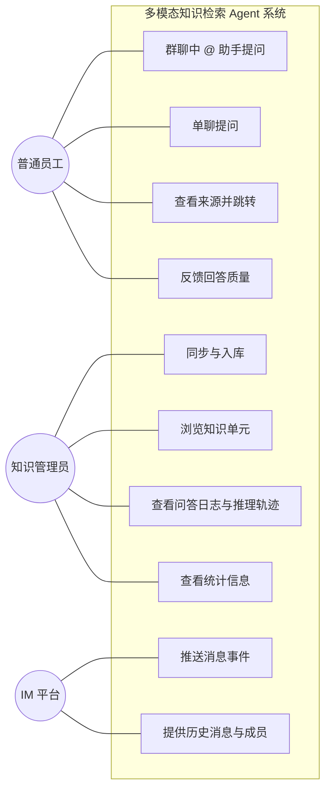

# 第3章 系统需求分析

本章从企业 IM 中知识获取的典型业务场景出发，分析系统的参与者、功能需求与非功能需求，并给出系统用例模型，为后续的方案设计和系统设计提供依据。

## 3.1 业务场景分析

为明确系统需要解决的问题，本文对企业研发、产品、运维、测试、销售和职能等岗位员工在 IM 中获取知识的过程进行了梳理，归纳出以下五类典型场景。

**场景一：新人查询流程规范。** 新入职员工需要了解开发环境搭建、账号申请、代码分支规范等信息。这些信息分散在入职群的历史消息和导师分享的文档附件中，新人往往不知道去哪里找，只能反复询问导师或同事。

**场景二：追溯历史决策与结论。** 员工需要了解某项技术选型的原因（如“灵犀项目为什么选 RocketMQ 而不是 Kafka”）、某个参数的当前配置值，或者某次故障的根因与改进措施。相关讨论可能发生在数周甚至数月之前，并与大量其他话题的消息交织在一起。

**场景三：查找截图、文档与表格中的信息。** 员工记得“之前有人发过一张报错截图”“某次压测有个 Excel 报告”，但只记得大致内容，不记得具体时间和发送人。关键信息只存在于图片、文档或表格中，基于消息文本的关键词搜索无法命中。

**场景四：获取语音消息中的结论。** 值班交接、客户沟通汇报等场景中，员工常以语音形式发送信息。语音内容无法被搜索，未及时收听的人很难获知其中的关键结论。

**场景五：跨群组综合查询。** 部分问题需要综合多个群聊中的信息才能回答，例如“客户 UAT 提出的问题后来是怎么解决的”，问题出现在项目群中，解决方案的交付记录可能在另一次讨论中。

上述场景反映出企业 IM 知识获取的共性痛点：知识碎片化且话题交织、多模态内容不可检索、历史信息难以定位、跨会话信息难以整合。同时，员工在提问时往往采用口语化、省略上下文的表达，期望得到准确、简洁且可核实来源的回答。此外，企业对信息安全有严格要求：员工只能获得自己有权访问的会话中的信息，涉及融资、薪酬、人事等敏感内容的管理层群聊信息绝不能被无权人员获取。

## 3.2 系统参与者

系统的参与者包括以下三类：

（1）**普通员工**：系统的主要使用者，通过 IM 在群聊中 @ 知识助手或与知识助手单聊提问，获取答案并查看来源；可对回答进行有用或无用的反馈。

（2）**知识管理员**：负责系统的运维与知识库管理，包括配置数据同步、触发全量或增量入库、浏览和检查知识单元、查看问答日志与推理轨迹、分析用户反馈等。

（3）**IM 平台**：外部系统参与者，提供会话、成员与历史消息的查询接口和实时消息事件推送，并接收知识助手发送的回复消息。

## 3.3 功能需求分析

根据业务场景，系统的功能需求划分为以下六个方面。

### 3.3.1 IM 接入与消息同步

（1）系统应支持通过适配器接入不同的 IM 平台，获取机器人可见的会话列表、会话成员与历史消息；

（2）系统应支持历史消息的全量同步和新消息的增量同步，记录每个会话的同步水位，避免重复处理；

（3）系统应能下载消息附件（图片、文档、表格、语音）到本地存储；

（4）系统应能实时接收消息事件，识别 @ 知识助手的提问或与知识助手单聊中的提问。

### 3.3.2 多模态内容解析

（1）文本消息：保留原文；

（2）图片消息：识别图中文字，并生成图片的语义描述（类型、核心内容、关键信息）；

（3）文档附件：支持 PDF、Word、PPT、TXT 等格式，按页面或章节抽取内容并分块，对扫描版页面自动进行文字识别；

（4）表格附件：支持 Excel、CSV 格式，保留表头与行列对应关系；

（5）语音消息：将语音转写为带标点的文本；

（6）单条消息解析失败时不应影响其他消息的处理，并记录失败原因。

### 3.3.3 知识库构建

（1）系统应能把同一会话中交织的消息按话题切分；

（2）系统应能以话题为单位构建会话知识单元，并为附件构建附件知识单元，保留证据消息与会话上下文；

（3）系统应能为知识单元生成标题、摘要与关键词，并为知识单元设置访问权限；

（4）系统应能对知识单元进行向量化并建立稠密、稀疏、视觉和词法索引；

（5）新消息到达后，系统应能增量更新受影响话题的知识单元。

### 3.3.4 智能问答

（1）系统应能理解口语化问题，结合对话上下文进行指代消解与查询改写；

（2）系统应能识别问题中的时间范围、会话范围和模态偏好等约束；

（3）系统应能拆分复杂问题，在信息不足时自主进行补充检索；

（4）系统应能基于检索证据生成回答，并逐句标注来源编号；

（5）回答应附带来源卡片，展示来源会话、发送人、时间和内容摘要，用户可点击跳转到原始消息；

（6）知识库中无相关信息或用户无权访问相关信息时，系统应如实说明，不得编造；

（7）存在新旧结论冲突时，系统应以较新的信息为准并指出变化；

（8）系统应支持闲聊类问题的简短回应，以及信息严重不足时的反问澄清。

### 3.3.5 权限控制

（1）系统应根据提问者所在的会话确定其可访问的知识范围；

（2）检索阶段应只返回提问者有权访问的知识单元；

（3）提问者不在某会话中时，不能跳转查看该会话的原始消息。

### 3.3.6 知识库管理

（1）系统应提供管理后台，展示会话数、消息数、话题数、知识单元数、向量数、问答次数、用户反馈和平均响应时间等统计信息；

（2）管理员可以触发增量同步或全量重建；

（3）管理员可以按会话、类型、关键词浏览知识单元及其内容、证据和权限；

（4）管理员可以查看问答日志及每次问答的智能体推理轨迹，用于问题分析与系统调优。

## 3.4 非功能需求分析

### 3.4.1 性能需求

（1）**响应时间**：在单机无 GPU 的部署条件下，单次检索（不含生成）的平均耗时应不超过 1 秒；端到端问答的平均响应时间应控制在 30 秒以内，并在等待期间给出处理中提示。在配备 GPU 的生产环境中，端到端响应时间应进一步缩短到数秒级。

（2）**检索效果**：在评测数据集上，系统前 5 个检索结果中包含正确证据的比例（Hit@5）应显著优于单一检索方式的基线。

（3）**问答效果**：端到端问答准确率应显著优于朴素 RAG 基线，回答中的引用应准确指向支撑证据。

### 3.4.2 安全性需求

（1）**数据不出域**：全部模型（大语言模型、视觉语言模型、嵌入模型、重排模型、OCR、语音识别）均应支持本地部署，企业数据不得发送给任何外部服务；

（2）**权限隔离**：在任何情况下都不能把无权访问的会话中的信息返回给用户，越权泄露率应为零；

（3）**可审计**：所有问答请求、回答、引用和推理轨迹应被完整记录，便于审计和追溯。

### 3.4.3 可靠性需求

单条消息解析失败、视觉模型或重排模型不可用时，系统应自动降级（例如仅使用 OCR 文本、跳过视觉检索通路），而不是整体不可用；检索结果为空或约束过严时，应自动放宽约束重试。

### 3.4.4 可扩展性与可维护性需求

（1）**平台无关**：通过适配器接口与 IM 平台解耦，接入新的 IM 平台时不需要修改上层模块；

（2）**模型可替换**：大模型通过 OpenAI 兼容接口调用，嵌入、重排、OCR、语音识别等模型可通过配置替换；

（3）**模块可配置**：检索各通路、重排、时效衰减以及智能体各节点均应支持通过配置开关，便于调优和实验。

## 3.5 系统用例模型

根据上述分析，系统的总体用例如图 3.1 所示。

图 3.1 系统用例图

核心用例“智能问答”的详细描述如表 3.1 所示。

表 3.1 “智能问答”用例描述

| 项目 | 描述 |
|---|---|
| 用例名称 | 智能问答 |
| 参与者 | 普通员工、IM 平台 |
| 前置条件 | 员工已登录 IM，知识库已完成入库 |
| 基本流程 | 1. 员工在群聊中 @ 知识助手或在单聊中输入问题；2. IM 平台推送消息事件；3. 系统识别提问并获取员工的权限主体；4. 系统结合会话上下文理解问题，执行权限感知的混合检索；5. 系统判断证据是否充分，必要时改写查询再次检索；6. 系统基于证据生成带来源编号的回答并校验引用；7. 系统以“回答 + 来源卡片”的形式回复；8. 员工可点击来源跳转到原始消息 |
| 扩展流程 | 4a. 问题为闲聊：直接简短回应；4b. 问题信息严重不足：反问澄清；5a. 无有权访问的相关证据：如实告知未找到；8a. 员工不在来源会话中：提示无法跳转 |
| 后置条件 | 问答记录与推理轨迹写入日志 |

“同步与入库”用例描述如表 3.2 所示。

表 3.2 “同步与入库”用例描述

| 项目 | 描述 |
|---|---|
| 用例名称 | 同步与入库 |
| 参与者 | 知识管理员、IM 平台 |
| 前置条件 | 系统已配置 IM 适配器 |
| 基本流程 | 1. 管理员触发同步（或新消息到达后自动触发）；2. 系统拉取各会话同步水位之后的新消息及附件；3. 系统按模态解析消息；4. 系统回溯活跃窗口进行话题切分；5. 系统删除受影响话题的旧知识单元，构建新的知识单元；6. 系统向量化并更新各类索引；7. 系统更新同步水位并返回统计信息 |
| 扩展流程 | 3a. 单条消息解析失败：记录错误并以占位文本入库；6a. 视觉模型不可用：跳过视觉索引 |
| 后置条件 | 知识库与 IM 消息保持同步 |

## 3.6 本章小结

本章分析了企业 IM 知识获取的五类典型业务场景，明确了系统的三类参与者；从 IM 接入、多模态解析、知识库构建、智能问答、权限控制和知识库管理六个方面梳理了功能需求，从性能、安全性、可靠性和可扩展性四个方面提出了非功能需求，并给出了系统用例模型与核心用例描述。
