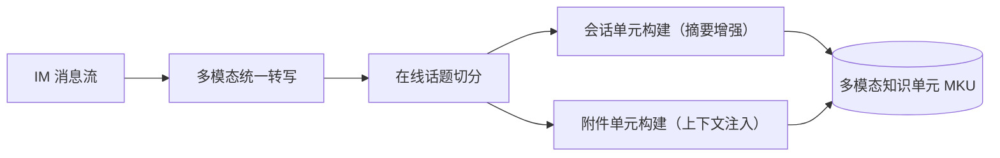
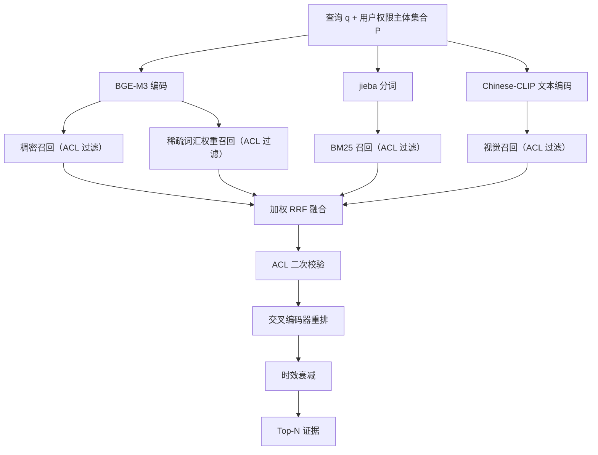
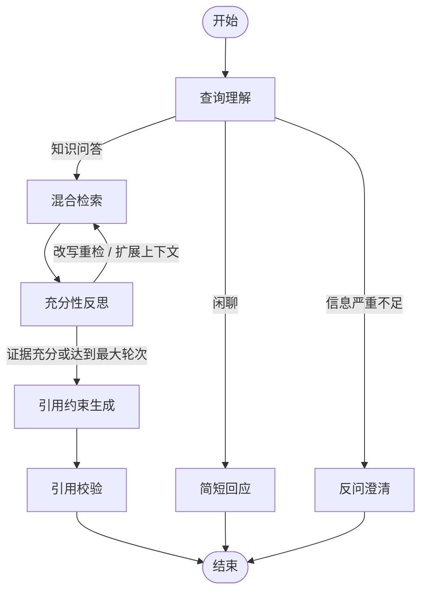

# 第4章 关键技术方案设计

本章针对第1章提出的三个核心问题，分别阐述面向 IM 会话的多模态知识单元构建、权限感知的多路混合检索以及基于 Agent 的检索规划与可溯源问答三项关键技术。每项技术按照“问题分析—方案设计—实现要点”的思路展开。

## 4.1 面向 IM 会话的多模态知识单元构建

### 4.1.1 问题分析

通用 RAG 系统通常把文档按固定长度切分为文本块作为检索单元。这种方式直接用于 IM 消息流会产生三个问题：

（1）**话题交织导致语义混杂。** 群聊中多个话题经常同时进行，例如研发群里一边讨论连接池参数，一边有人询问会议室预订。按时间窗口或消息条数切分，会把不同话题的消息混入同一个检索单元，降低语义一致性；同一话题的消息也可能被切到多个单元中，导致检索时只能召回问题而召回不到结论。

（2）**单条消息信息量低。** IM 消息普遍短小、口语化，“好的”“收到”“+1”等消息几乎不含语义信息，“改成 50 了”这类消息脱离上下文后无法被理解，也难以被检索到。

（3）**多模态内容脱离语境。** 一张报错截图本身只包含日志文字，只有结合“用户中心刷新 token 又报错了”的上下文，才能明确它与哪个系统、哪次故障有关。附件单独入库会丢失这些语境信息。

为此，本文提出面向 IM 会话的多模态知识单元构建方法，流程如图 4.1 所示。首先对各模态消息进行统一转写；然后通过在线话题切分把消息流解缠为话题；最后以话题为单位构建会话单元，并为附件构建注入上下文的附件单元。

图 4.1 多模态知识单元构建流程

### 4.1.2 多模态内容统一转写

本文把所有模态的内容统一转写为文本，使其能够进入统一的文本检索通路；同时为图片和文档页面保留图像路径，供视觉检索通路使用。各模态的转写策略如表 4.1 所示。

表 4.1 各模态内容转写策略

| 模态 | 转写方法 | 输出形式 |
|---|---|---|
| 文本 | 保留原文 | 消息文本 |
| 图片 | OCR 文字识别 + 视觉语言模型描述 | 【图片描述】…【图中文字】… |
| 文档 | PDF 文本层抽取（文本过少的页面回退 OCR）；Word 按标题层级分节；PPT 按页抽取 | 【文档】文件名·页码/章节 + 分块文本 |
| 表格 | 表头重复 + 行级“列名: 值”序列化 | 【表格】表名 + 表头 + 序列化行 |
| 语音 | VAD + Paraformer 识别 + 标点恢复 | 【语音转写】… |

**（1）图片的互补表示。** 企业 IM 中的图片以截图为主，包括终端日志、系统界面、监控图表和白板架构图等。若只使用 OCR，可以准确获得错误码、IP 地址、版本号等文字，却无法理解图表的趋势与关系；若只使用视觉语言模型，可以理解图片类型和语义，但小参数模型容易遗漏或误识别精确的字符串。因此，本文采用两者互补的表示：

$$T_{\mathrm{img}}=\left[\,\text{【图片描述】}\oplus \mathrm{VLM}(I, p_{\mathrm{cap}})\,;\ \text{【图中文字】}\oplus \mathrm{OCR}(I)\,\right] \tag{4.1}$$

式中，$I$ 为图片，$p_{\mathrm{cap}}$ 为描述提示词，要求模型输出图片类型、核心内容与关键信息，并保留可见的标题和关键字段原文，不得编造看不清的内容；$\oplus$ 表示拼接。OCR 结果按文本框纵坐标聚合成行，再按横坐标排序，以恢复阅读顺序。

**（2）表格的行级序列化。** 表格直接展平为文本会丢失行列对应关系，例如“创建订单 500 1260 310”无法表达各数值的含义，导致“创建订单接口的 P99 是多少”这类问题无法检索和回答。本文将表格按每 $N$ 行（默认 15 行）分块，每块重复携带表名与表头，并把每行序列化为“列名: 值”的键值对形式，例如“接口: 创建订单；并发: 500；TPS: 1260；P99(ms): 310”。

**（3）文档的结构感知分块。** 文档按“段落—句子”的层级边界聚合为不超过 500 字的文本块，相邻块之间保留 80 字重叠；每个块都携带文件名与页码（或章节路径）前缀，保证块在脱离文档后仍能被定位。

### 4.1.3 融合语义、结构与时间的在线话题切分

**（1）问题定义。** 给定会话中按时间排序的消息序列 $M=(m_1,m_2,\dots,m_n)$，话题切分的目标是把 $M$ 划分为若干话题 $\mathcal{T}=\{T_1,T_2,\dots,T_k\}$，每个话题是一组讨论同一主题的消息（不要求时间连续）。与传统的线性话题分割不同，这里允许话题在时间上交织，本质上是会话解缠问题[@G1][@G2]。

**（2）亲和度建模。** 本文将切分建模为“消息归属活跃话题”的在线决策过程：按时间顺序处理每条消息 $m$，计算它与每个活跃话题 $T$ 的亲和度：

$$S(m,T)=\alpha\cdot \mathrm{Sim}(m,T)+\beta\cdot \mathrm{Rel}(m,T)+\gamma\cdot \exp\!\left(-\frac{\Delta t(m,T)}{\tau}\right) \tag{4.2}$$

式中，三项分别刻画语义、结构和时间三类线索，$\alpha$、$\beta$、$\gamma$ 为权重系数，在开发集上选定为 0.6、0.2、0.2（见 7.3 节）。

语义项 $\mathrm{Sim}(m,T)$ 为消息向量与话题质心的余弦相似度。为适应讨论过程中的话题漂移，话题质心采用指数滑动平均更新，近期消息权重更高：

$$\boldsymbol{c}_T\leftarrow \frac{\lambda\,\boldsymbol{c}_T+(1-\lambda)\,\boldsymbol{e}_m}{\left\|\lambda\,\boldsymbol{c}_T+(1-\lambda)\,\boldsymbol{e}_m\right\|} \tag{4.3}$$

式中，$\boldsymbol{e}_m$ 为消息 $m$ 的 BGE-M3 稠密向量，$\lambda$ 为衰减系数（默认 0.7）。附件消息的向量由其附言与转写文本的前 200 字计算。

结构项 $\mathrm{Rel}(m,T)$ 利用 IM 中显式的结构信号：

$$\mathrm{Rel}(m,T)=\begin{cases}1.0, & m \text{ 回复了 } T \text{ 中的消息}\\ 0.6, & m \text{ @ 了 } T \text{ 的近期发言人}\\ 0.5, & m \text{ 与 } T \text{ 的最后一条消息为同一发言人且间隔小于 2 分钟}\\ 0, & \text{其他}\end{cases} \tag{4.4}$$

时间项中，$\Delta t(m,T)$ 为消息 $m$ 与话题 $T$ 最后一条消息的时间间隔，$\tau$ 为时间尺度（选定为 15 分钟）。

**（3）归属决策。** 若 $\max_T S(m,T)\ge\theta$（默认 $\theta=0.45$），则把 $m$ 归入亲和度最高的话题，否则新建话题。对于“好的”“收到”“+1”等低信息量消息，语义向量不可靠，本文通过规则识别（长度不超过 2 个字符或匹配常见应答词表）后，优先依据结构关系归属，没有结构关系时归入最近活跃的话题，且不用其向量更新话题质心。此外，超过活跃窗口（默认 6 小时）未更新或消息数达到上限（默认 40 条）的话题会被关闭，不再接收新消息。

算法 4.1 给出了在线话题切分的完整流程。

> **算法 4.1 在线话题切分**
>
> 输入：按时间排序的消息序列 $M$，消息文本与向量，参数 $\alpha,\beta,\gamma,\theta,\tau$
> 输出：话题集合 $\mathcal{T}$
>
> 1. 初始化活跃话题集合 $A\leftarrow\emptyset$，已关闭话题集合 $C\leftarrow\emptyset$
> 2. **for** 每条消息 $m\in M$ **do**
> 3. 　　把 $A$ 中超出活跃窗口或已满的话题移入 $C$
> 4. 　　**if** $A=\emptyset$ **then** 新建话题 $\{m\}$ 加入 $A$；**continue**
> 5. 　　**if** $m$ 为低信息量消息且无回复关系 **then**
> 6. 　　　　$T^*\leftarrow$ 结构关系最强的话题，若均为 0 则取最近活跃话题
> 7. 　　**else**
> 8. 　　　　$T^*\leftarrow\arg\max_{T\in A}S(m,T)$；**if** $S(m,T^*)<\theta$ **then** $T^*\leftarrow$ 新话题
> 9. 　　把 $m$ 加入 $T^*$，若 $m$ 非低信息量消息则按式（4.3）更新质心
> 10. **end for**
> 11. **return** $\mathcal{T}=A\cup C$

该算法对每条消息只需与少量活跃话题比较，时间复杂度为 $O(n\cdot|A|)$，支持新消息到达时的增量处理。

### 4.1.4 多模态知识单元的构建

**（1）MKU 定义。** 多模态知识单元是系统中检索、生成与引用的基本粒度，形式化定义为：

$$\mathrm{MKU}=\langle id,\ conv,\ topic,\ kind,\ \mathcal{M},\ title,\ content,\ E,\ [t_s,t_e],\ ACL,\ img\rangle \tag{4.5}$$

式中，$kind\in\{\text{dialog},\text{attachment}\}$ 为单元类型；$\mathcal{M}$ 为包含的模态集合；$content$ 为用于检索与生成的规范化文本；$E$ 为证据消息 ID 集合，用于回答溯源和跳转；$[t_s,t_e]$ 为时间范围；$ACL$ 为访问控制列表；$img$ 为可选的图像路径，用于视觉检索。

**（2）会话单元与摘要增强。** 对每个话题，把其中的消息按“[时间] 发言人：内容”的格式组织为对话文本，附件消息以其转写结果的摘要代替。口语化的对话文本与员工规范化的提问之间存在表达差异，为此本文调用大模型为包含 3 条以上消息的话题生成标题、摘要与关键词，并作为前缀加入会话单元：

> 【群聊】后端研发群｜【话题】订单服务连接池参数调整
> 【摘要】王强 8 月 4 日将订单服务 HikariCP maximumPoolSize 由 20 调至 50……
> 【关键词】连接池、HikariCP、订单服务、压测
> [2026-08-04 10:20] 王强：张哥，我这边调整了订单服务数据库连接池的参数……

摘要要求保留结论、决策、负责人、时间与数值等关键信息，相当于把隐含在多轮对话中的结论显式化，从而缩小查询与对话之间的语义鸿沟。超过 1500 字的长话题按窗口切分为多个会话单元，相邻窗口重叠 2 条消息，所有窗口共享同一标题与摘要。

**（3）附件单元与上下文注入。** 每个文档分块、表格分块、图片和语音都单独构建为附件单元，并在内容前注入上下文头：

> 【来源】群聊“后端研发群”｜李娜｜2026-08-11 15:05｜话题：用户中心接口报错排查
> 【图片描述】报错截图，用户中心刷新 token 失败……【图中文字】……errorCode=UC-5031……

上下文头包含来源会话、发送人、发送时间、所属话题标题和附言，使附件在脱离会话后依然具备完整语境。附件单元的证据集合包含附件消息本身及其前后各 2 条消息，便于回答时同时展示附件与相关讨论。

**（4）访问控制列表。** 知识单元的 ACL 继承其来源会话的可见范围，表示为权限主体集合，例如 $\{\text{conv:c\_backend}\}$。用户的权限主体集合在查询时动态计算（见 4.2.4 节），因此成员变动无需重建索引。

### 4.1.5 增量更新

新消息到达时，系统只回溯每个会话最近一个活跃窗口（6 小时）内的消息重新切分，删除这些消息原先所属话题的知识单元及其向量，再构建新的知识单元并写入索引。由于活跃窗口之前的话题已经关闭、不会再接收新消息，该策略在保证结果与全量构建一致的前提下，把增量更新的计算量限制在常数规模。

## 4.2 权限感知的多路混合检索

### 4.2.1 问题分析

企业 IM 知识检索的查询具有多样性：既有“为什么选 RocketMQ”这类需要语义理解的问题，也有“UC-5031 是什么错误”这类依赖精确词项匹配的问题，还有“之前那张架构图”这类指向视觉内容的问题。单一检索方式难以兼顾：稠密检索擅长语义匹配，但对错误码、IP 地址、版本号等精确字符串不敏感；稀疏检索擅长精确匹配，但无法处理同义改写；文本检索无法覆盖转写信息不完整的视觉内容。

同时，权限控制必须在检索阶段完成。若采用“先检索 Top-$K$、再按权限过滤”的后过滤方式，当用户可访问的数据只占少数时，过滤后的结果可能所剩无几（召回不足）；而且一旦过滤逻辑有缺陷，就会导致越权泄露。

### 4.2.2 三路召回

本文设计的混合检索流程如图 4.2 所示。

图 4.2 权限感知的多路混合检索流程

（1）**稠密语义通路**：使用 BGE-M3 的稠密向量，在向量库中按内积检索 Top-$K_d$（默认 30）个知识单元。

（2）**稀疏词项通路**：包括两种信号。一是 BGE-M3 输出的词汇权重稀疏向量，它由模型学习得到，能够为重要词项赋予更高权重；二是基于 jieba 分词的 BM25，它对未登录的错误码、IP 地址等字符串更加稳健。两者各取 Top-$K_s$（默认 30）。

（3）**视觉通路**：使用 Chinese-CLIP 文本编码器编码查询，在图片和文档页面的图像向量中检索 Top-$K_v$（默认 10），作为文本转写之外的补充信号。企业截图以文字为主，通用图文模型对这类图像的区分能力有限，图文相似度在相关与不相关结果之间重叠较多。为避免视觉通路在图片数量较少时“无差别”地返回全部图片、干扰融合排序，本文设置相似度门限（默认 0.40），只有超过门限的结果才参与融合。

### 4.2.3 加权 RRF 融合、重排与时效衰减

**（1）加权 RRF 融合。** 本文在式（2.4）的基础上为各通路引入权重：

$$\mathrm{RRF}_w(d)=\sum_{r\in R}\frac{w_r}{k+\mathrm{rank}_r(d)} \tag{4.6}$$

式中，$w_r$ 为通路权重，默认稠密 1.0、BGE-M3 稀疏 0.7、BM25 0.7、视觉 0.3，$k=60$；当查询理解识别出“找图片”意图时，视觉通路权重提高到 1.0。融合后保留前 30 个候选。

**（2）交叉编码器重排。** 使用 bge-reranker-v2-m3 对（查询，知识单元内容）进行精细打分，并经 Sigmoid 函数归一化到 $[0,1]$，记为 $s_{\mathrm{rr}}(q,d)$。

**（3）时效衰减。** 企业知识存在“新结论覆盖旧结论”的特点，例如连接池参数被再次调整、发布窗口被修改。为在相关性相近时优先返回较新的信息，本文对重排分数施加时效衰减：

$$s(q,d)=(1-\mu)\,s_{\mathrm{rr}}(q,d)+\mu\cdot 0.5^{\,\Delta_d/h} \tag{4.7}$$

式中，$\Delta_d$ 为知识单元最后一条消息距参考时间的天数，$h$ 为半衰期（默认 180 天），$\mu$ 为衰减权重（默认 0.1）。$\mu$ 取较小值，保证相关性仍是排序的主导因素，时效只在相关性接近时起调节作用。

### 4.2.4 基于 ACL 的前置过滤

**（1）权限主体计算。** 用户 $u$ 的权限主体集合定义为：

$$P(u)=\{\text{user}:u\}\cup\{\text{conv}:c\mid u\in \mathrm{members}(c)\}\cup\{\text{dept}:\mathrm{dept}(u)\} \tag{4.8}$$

该集合在每次查询时通过 IM 适配器实时计算，因此员工入群、退群后权限立即生效。

**（2）过滤下推。** 知识单元 $d$ 对用户 $u$ 可见，当且仅当 $ACL(d)\cap P(u)\ne\emptyset$。本文把该条件表达为向量数据库的标量过滤表达式 `array_contains_any(acl, P(u))`，在稠密、稀疏和视觉检索中与近似最近邻搜索同时执行，使每一路召回的 Top-$K$ 都只来自用户有权访问的数据，从根本上避免后过滤造成的召回不足；BM25 通路在打分后同样只保留满足条件的文档。

**（3）纵深防御。** 在融合结果返回前，系统按同样的规则对每个候选再做一次校验。即使某一路索引的过滤因配置错误而失效，越权数据也不会进入生成阶段。此外，回答中的来源跳转同样受权限约束：用户不在来源会话中时，前端不允许跳转查看原始消息。

## 4.3 基于 Agent 的检索规划与可溯源问答

### 4.3.1 问题分析

单轮“检索—生成”的朴素 RAG 流程在企业 IM 场景下存在以下不足：

（1）员工提问常口语化、省略上下文，例如在讨论灵犀项目的群里问“那上线时间定了吗”，直接用原问题检索效果很差；

（2）问题可能包含时间范围（“上个月”）、会话范围（“研发群里”）或模态偏好（“那张截图”）等隐含约束；

（3）多跳问题需要分步检索，例如“最终选定的意图模型 F1 是多少”需要先找到选型结论，再找到评测数据；

（4）首次检索不一定能拿到充分证据，需要改写查询重试或扩展上下文；

（5）回答必须可溯源，且大模型可能产生与证据不符的“伪引用”。

### 4.3.2 智能体状态图设计

本文基于状态图设计检索智能体，结构如图 4.3 所示。

图 4.3 检索智能体状态图

智能体在各节点之间传递共享状态，包括原始问题、提问者及其权限主体、会话上下文、查询理解结果、已执行的查询列表、累计证据、迭代轮次、反思结果、回答与引用，以及完整的推理轨迹。推理轨迹记录每个节点的输入输出，用于可解释性展示和问题诊断。

### 4.3.3 查询理解

查询理解节点把提问所在会话的名称、最近 8 条消息和当前时间作为上下文提供给大模型，要求输出结构化结果：

（1）**意图**：知识问答、找文件、找图片、闲聊或需要澄清；

（2）**独立查询**：消解指代、补全省略后的完整检索查询，例如把“那上线时间定了吗”改写为“灵犀项目正式上线时间”；

（3）**子查询**：对包含多个子问题或需要多跳推理的问题，拆分为 1 至 3 个子查询；

（4）**约束条件**：模态偏好、时间范围和会话范围。

时间范围被转换为对知识单元时间字段的标量过滤条件，会话范围通过会话名称匹配转换为会话 ID 过滤条件。为避免约束识别错误导致检索结果为空，当带约束的检索没有返回结果时，系统自动去除约束重新检索。

### 4.3.4 检索充分性反思

检索节点对独立查询和各子查询分别调用 4.2 节的混合检索，结果按知识单元合并去重，保留最高分。随后，反思节点把问题、已执行的查询和前 6 条证据交给大模型，要求判断：

（1）现有证据能否完整、准确地回答问题；

（2）哪些证据对回答有用；

（3）下一步动作：直接回答、换一种说法或针对缺失信息重新检索、扩展某条证据的上下文。

若选择重新检索，大模型给出新查询，智能体回到检索节点，新结果与已有证据合并；若选择扩展上下文，系统取该证据所属话题的其他会话单元补充到证据集合中。有用证据被调整到证据列表前部，以缓解大模型对长上下文中间信息利用不足的问题[@C13]。迭代轮次达到上限（默认 3 轮）时强制进入生成。此外，系统以重排分数作为规则兜底：若最高分低于阈值（默认 0.35），则标记为低置信，提醒生成阶段谨慎作答。这一设计借鉴了 Self-RAG[@C6] 与 CRAG[@C7] 的思想，但不需要额外训练模型，而是通过提示词与规则实现，适合私有化场景中的小参数模型。

### 4.3.5 引用约束生成与引用校验

**（1）引用约束生成。** 生成前，系统先执行相关性门限过滤：重排分数低于门限（默认 0.05）的证据不进入生成阶段；若没有证据通过门限，则直接回复“在你有权限访问的群聊和文件中没有找到相关记录”。这一步可以防止大模型在只拿到无关证据时“张冠李戴”地强行作答，对权限隔离场景尤为重要：无权用户检索不到敏感证据时，系统不会用其他不相关的内容拼凑答案。随后，生成节点把证据编号为 [1]、[2]……，每条证据附带类型（会话记录或附件及其模态）和时间，并在提示词中约束：只能使用证据中的信息；每个关键事实句末用编号标注来源；证据不足时明确说明“根据现有记录无法确定”；证据冲突时以时间较新者为准并指出变化。

**（2）引用校验。** 生成的回答可能包含越界编号或“伪引用”，即标注了某条证据，但该证据并不支持对应的句子。本文对回答进行两步校验：先剔除超出证据范围的编号；再把回答按句切分，对每个“句子—被引证据”对使用交叉编码器计算支撑度，删除支撑度低于阈值（默认 0.02）的引用。最终，回答中保留的编号映射为来源卡片，展示来源会话、发送人、时间和内容摘要，并关联证据消息 ID，用户可点击跳转到原始消息。

## 4.4 本章小结

本章详细阐述了系统的三项关键技术。在知识单元构建方面，提出了 OCR 与视觉语言模型互补的图片表示、表格行级序列化，以及融合语义、结构与时间三类线索的在线话题切分方法，并设计了带摘要增强的会话单元和带上下文注入的附件单元。在混合检索方面，设计了稠密、稀疏、视觉三路召回，结合加权 RRF 融合、交叉编码器重排与时效衰减，并通过 ACL 过滤下推与二次校验实现了权限隔离。在智能体方面，设计了包含查询理解、检索、充分性反思、引用约束生成和引用校验的状态图，使系统能够处理口语化、带约束和多跳的问题，并给出可溯源的回答。
