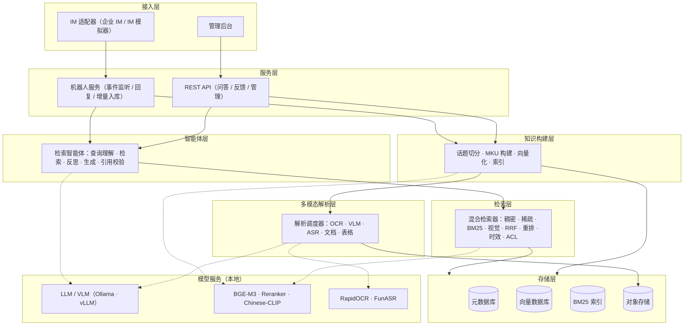
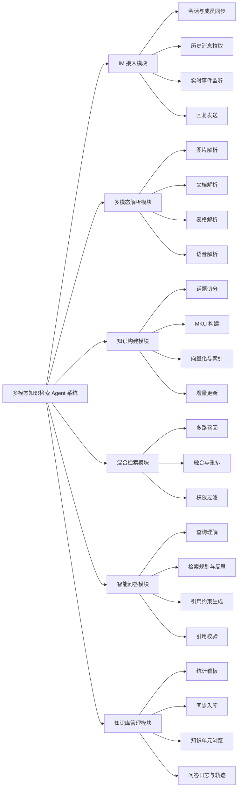
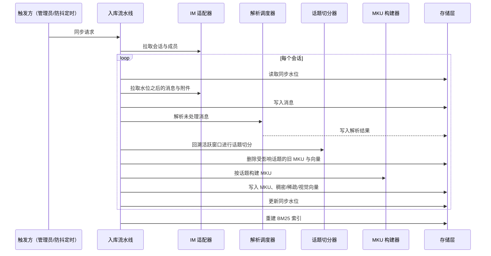
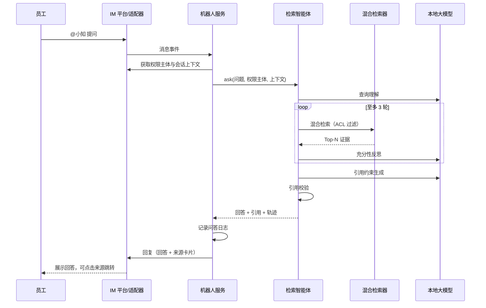
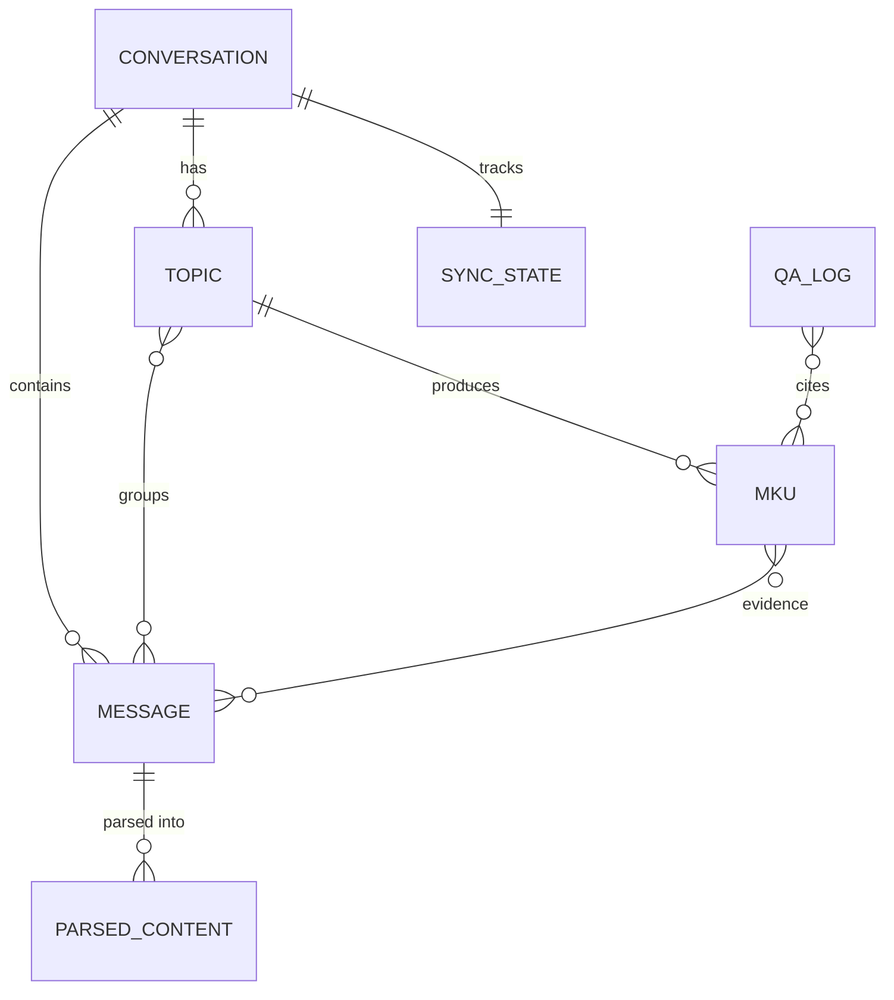

# 第5章 系统总体设计

本章在需求分析与关键技术方案的基础上，给出系统的总体设计，包括设计原则、总体架构、功能模块、数据库、接口以及部署架构。

## 5.1 设计原则

（1）**平台解耦**：通过 IM 适配器抽象层屏蔽不同 IM 平台的差异，上层模块只依赖统一的消息模型与接口。

（2）**数据不出域**：所有模型均采用可本地部署的开源模型，通过 OpenAI 兼容接口或本地推理库调用，企业数据不经过任何外部服务。

（3）**安全优先**：权限控制贯穿检索、生成与展示全过程，采用前置过滤与二次校验的纵深防御策略。

（4）**分层与可配置**：系统按职责分层，各层之间通过明确的数据结构交互；检索通路、重排、智能体节点等均可通过配置开关，便于调优与实验。

（5）**优雅降级**：视觉模型、重排模型或单条消息解析失败时，系统自动降级而非整体不可用。

## 5.2 系统总体架构

系统采用分层架构，自下而上分为存储层、多模态解析层、知识构建层、检索层、智能体层、服务层和接入层，如图 5.1 所示。

图 5.1 系统总体架构

各层职责如下：

（1）**接入层**：IM 适配器负责与具体 IM 平台交互，把平台的原始事件和数据归一化为统一的消息模型；管理后台为知识管理员提供可视化界面。

（2）**服务层**：机器人服务监听实时消息事件，识别提问并调用智能体作答，同时在新消息到达后以防抖方式触发增量入库；REST API 对外提供问答、反馈与管理接口。

（3）**智能体层**：基于状态图实现检索规划、充分性反思、引用约束生成与引用校验。

（4）**检索层**：实现权限感知的多路混合检索。

（5）**知识构建层**：实现话题切分、知识单元构建、向量化与索引更新，支持全量与增量两种模式。

（6）**多模态解析层**：根据消息类型与附件格式调度对应的解析器，输出统一的解析结果。

（7）**存储层**：元数据库存储会话、消息、解析结果、话题、知识单元与问答日志；向量数据库存储文本与视觉向量；BM25 索引存储分词结果；对象存储保存附件与文档页面图像。

## 5.3 功能模块设计

系统功能模块划分如图 5.2 所示。

图 5.2 系统功能模块图

**（1）IM 接入模块。** 定义适配器抽象接口，实现会话与成员同步、历史消息拉取、附件下载、实时事件监听和回复发送。本文实现了 IM 模拟器适配器，用于系统演示与评测；企业 IM 适配器按同一接口实现。

**（2）多模态解析模块。** 解析调度器根据消息类型与附件扩展名，把消息路由到图片、文档、表格或语音解析器，输出统一的解析结果（模态、转写文本、分块序号、元数据、图像路径）。

**（3）知识构建模块。** 包括在线话题切分器、知识单元构建器和入库流水线。入库流水线依次执行同步、解析、切分、构建、向量化和索引，并维护每个会话的同步水位。

**（4）混合检索模块。** 实现多路召回、加权 RRF 融合、交叉编码器重排、时效衰减与权限过滤，对外提供带检索配置参数的统一检索接口。

**（5）智能问答模块。** 实现检索智能体的状态图，以及把回答和引用组装为来源卡片的逻辑。

**（6）知识库管理模块。** 提供统计看板、同步入库、知识单元浏览和问答日志查看功能。

## 5.4 核心流程设计

### 5.4.1 知识入库流程

知识入库流程如图 5.3 所示。

图 5.3 知识入库时序图

### 5.4.2 智能问答流程

智能问答流程如图 5.4 所示。

图 5.4 智能问答时序图

## 5.5 数据库设计

### 5.5.1 概念结构设计

系统的核心实体包括会话、消息、解析结果、话题、知识单元和问答日志，其关系如图 5.5 所示：一个会话包含多条消息；一条消息可产生多条解析结果（如文档的多个分块）；一个话题由同一会话中的多条消息组成；一个话题产生一个或多个会话单元以及若干附件单元；问答日志通过引用关联知识单元。

图 5.5 系统 E-R 图

### 5.5.2 逻辑结构设计

元数据库的主要数据表如表 5.1 至表 5.4 所示。

表 5.1 消息表（messages）

| 字段名 | 类型 | 说明 |
|---|---|---|
| msg_id | TEXT | 消息 ID，主键 |
| conv_id | TEXT | 所属会话 ID |
| sender_id / sender_name | TEXT | 发送人 ID / 姓名 |
| ts | REAL | 发送时间戳（秒） |
| type | TEXT | 消息类型：text / image / file / audio / system |
| text | TEXT | 消息文本或附言 |
| attachment | TEXT | 附件信息（JSON：文件 ID、名称、MIME、大小、本地路径） |
| reply_to | TEXT | 被回复消息 ID |
| mentions | TEXT | 被 @ 用户列表（JSON） |
| parsed | INTEGER | 是否已解析 |

表 5.2 解析结果表（parsed_contents）

| 字段名 | 类型 | 说明 |
|---|---|---|
| id | INTEGER | 自增主键 |
| msg_id | TEXT | 来源消息 ID |
| modality | TEXT | 模态：text / image / document / table / audio |
| text | TEXT | 统一转写文本 |
| chunk_index | INTEGER | 分块序号 |
| meta | TEXT | 元数据（JSON：页码、章节、工作表、OCR 文本、图片描述等） |
| image_path | TEXT | 图像路径（用于视觉检索） |

表 5.3 知识单元表（mkus）

| 字段名 | 类型 | 说明 |
|---|---|---|
| mku_id | TEXT | 知识单元 ID，主键 |
| conv_id / topic_id | TEXT | 所属会话 / 话题 |
| kind | TEXT | 类型：dialog / attachment |
| modalities | TEXT | 包含的模态（JSON） |
| title | TEXT | 标题 |
| content | TEXT | 规范化内容 |
| evidence | TEXT | 证据消息 ID 列表（JSON） |
| ts_start / ts_end | REAL | 时间范围 |
| acl | TEXT | 访问控制列表（JSON） |
| image_path | TEXT | 图像路径 |
| meta | TEXT | 元数据（JSON：摘要、关键词、分块信息等） |

表 5.4 问答日志表（qa_logs）

| 字段名 | 类型 | 说明 |
|---|---|---|
| id | INTEGER | 自增主键 |
| user_id / conv_id | TEXT | 提问者 / 提问所在会话 |
| question / answer | TEXT | 问题 / 回答 |
| citations | TEXT | 引用列表（JSON） |
| trace | TEXT | 智能体推理轨迹（JSON） |
| latency_ms | REAL | 响应耗时 |
| feedback | INTEGER | 用户反馈：1 有用，-1 无用 |
| created_at | REAL | 创建时间 |

此外，会话表（conversations）记录会话 ID、名称、类型、部门与成员列表；话题表（topics）记录话题 ID、所属会话、消息 ID 列表与时间范围；同步状态表（sync_state）记录各会话的同步水位。

### 5.5.3 向量集合设计

向量数据库包含两个集合，结构如表 5.5 所示。

为保障异构存储间的数据一致性，系统以 SQLite 元数据库作为主事实来源（Source of Truth）：每次同步均以话题及其包含的消息 ID 列表为单位计算影响范围，先在 Milvus 两个集合中删除受影响旧话题对应的全部 MKU 向量，再删除并重写 SQLite 中对应的 `mkus` 记录，随后插入新生成的稠密/稀疏/视觉向量，并在全部会话增量同步完成后统一重建 BM25 内存倒排索引；同步水位 `sync_state.last_ts` 仅在单个会话写入全部成功之后才提交更新。由于 `mku_id` 基于会话、话题和窗口序号生成具有幂等性，即使系统在同步过程中意外中断，重启后重新回溯水位并重跑受影响窗口，也不会产生孤立向量或重复知识单元。

表 5.5 向量集合设计

| 集合 | 字段 | 类型 | 索引/说明 |
|---|---|---|---|
| mku_text | mku_id | VARCHAR(64) | 主键 |
|  | dense | FLOAT_VECTOR(1024) | BGE-M3 稠密向量，内积；原型 FLAT，生产 HNSW |
|  | sparse | SPARSE_FLOAT_VECTOR | BGE-M3 词汇权重，稀疏倒排索引，内积 |
|  | acl | ARRAY&lt;VARCHAR&gt; | 权限主体，用于过滤下推 |
|  | conv_id / kind / ts_end | VARCHAR / VARCHAR / DOUBLE | 标量过滤字段 |
| mku_visual | mku_id | VARCHAR(64) | 主键 |
|  | clip | FLOAT_VECTOR(512) | Chinese-CLIP 图像向量，内积 |
|  | acl / conv_id / ts_end | ARRAY / VARCHAR / DOUBLE | 标量过滤字段 |

## 5.6 接口设计

### 5.6.1 IM 适配器接口

IM 适配器抽象接口定义如表 5.6 所示。任何 IM 平台只需实现这些方法即可接入系统。

表 5.6 IM 适配器接口

| 方法 | 说明 |
|---|---|
| list_conversations() | 返回机器人可见的会话列表（含成员） |
| fetch_history(conv_id, since_ts) | 按时间升序返回会话中指定时间之后的消息 |
| download_attachment(att, dest_dir) | 下载附件到本地对象存储，返回本地路径 |
| events() | 异步返回实时消息事件流 |
| send_message(conv_id, text, reply_to, card) | 发送消息，可附带结构化来源卡片 |
| get_user_principals(user_id) | 返回用户的权限主体集合 |
| is_bot_mentioned(msg, bot_id) | 判断消息是否 @ 了机器人 |

### 5.6.2 服务端 REST 接口

服务端对外提供的主要接口如表 5.7 所示。

表 5.7 服务端主要接口

| 方法与路径 | 说明 |
|---|---|
| POST /api/ask | 问答：输入用户 ID、问题、会话 ID，返回回答、引用、来源卡片与推理轨迹 |
| POST /api/feedback | 提交回答反馈 |
| POST /admin/ingest | 触发增量同步或全量重建，返回入库统计 |
| GET /admin/stats | 获取统计信息 |
| GET /admin/mkus | 按会话、类型、关键词分页查询知识单元 |
| GET /admin/qa_logs | 查询问答日志与推理轨迹 |
| GET /im/convs、GET/POST /im/convs/{id}/messages | IM 模拟器的会话与消息接口（校验成员身份） |
| WS /im/ws | IM 模拟器的实时消息推送 |

## 5.7 部署架构与安全设计

### 5.7.1 单机原型与生产部署形态

系统支持两种部署形态，如表 5.8 所示。

表 5.8 系统部署形态

| 组件 | 单机原型（开发、演示与评测） | 企业生产部署 |
|---|---|---|
| 大模型推理 | Ollama：Qwen3-8B（4 比特量化）、Qwen2.5-VL-3B | vLLM：Qwen3-14B/32B、Qwen2.5-VL-7B，GPU 服务器 |
| 嵌入与重排 | BGE-M3、bge-reranker-v2-m3、Chinese-CLIP（MPS/CPU） | 同左，GPU 推理服务 |
| OCR / ASR | RapidOCR（ONNX）、FunASR Paraformer（CPU） | 同左，可横向扩展 |
| 向量数据库 | Milvus Lite（本地文件） | Milvus 分布式集群 |
| 元数据库 | SQLite | PostgreSQL |
| 词法索引 | 内存 BM25 | Elasticsearch |
| 对象存储 | 本地目录 | MinIO |
| 服务 | FastAPI 单进程 | 多实例 + 负载均衡，解析与入库任务异步队列 |
| 网络 | 本机 | 企业内网，模型服务不开放外网 |

原型环境在一台 16 GB 内存、无独立 GPU 的笔记本电脑上即可运行全部组件；生产部署中，各组件通过配置切换为对应的服务端实现，上层代码无需修改。

### 5.7.2 安全隔离与容错降级设计

在企业内部知识检索场景下，越权访问是核心安全风险。系统在设计上建立四道纵深防御边界：（1）**接入鉴权隔离**：IM 模拟器消息查看与发送接口校验请求用户是否在目标会话成员集合中，非成员请求直接返回 HTTP 403 拒绝状态；（2）**检索过滤下推**：检索前通过适配器实时查询当前提问用户的权限主体集合，并将 `acl` 数组过滤表达式直接传入 Milvus 检索过滤器和 BM25 倒排过滤环节；（3）**应用层二次校验**：RRF 融合后从 SQLite 读取 MKU 元数据时再次比对 `MKU.acl` 与用户权限主体的交集，防止任何索引层异常导致越权；（4）**前端跳转防越权**：来源卡片跳转前校验目标会话是否属于当前用户可见列表，否则阻断跳转并给出提示。

在系统可靠性与容错降级方面，各重负载或外部依赖组件均配置局部降级路径：图片解析调用 Qwen2.5-VL 超时或异常时自动保留 OCR 文本输出；语音解析默认在独立子进程中加载 FunASR 执行 CPU 推理，隔离语音运行时与向量库 gRPC 线程及 Metal 上下文互扰；若检索期视觉模型（Chinese-CLIP）不可用，系统记录告警并自动退化为文本与词法三路召回，确保核心问答服务连续可用。此外，全部问答请求与多步推理轨迹均记录至 `qa_logs` 表，满足企业合规审计与事后追踪需求。

## 5.8 本章小结

本章给出了系统的总体设计：提出了平台解耦、数据不出域、安全优先、分层可配置与优雅降级五项设计原则；设计了七层系统架构和六大功能模块，以及知识入库与智能问答两条核心流程；完成了元数据库、向量集合与异构索引一致性设计；定义了 IM 适配器接口与服务端 REST 接口；给出了单机原型与企业生产两种部署形态，并明确了四层权限纵深防御与容错降级机制。
