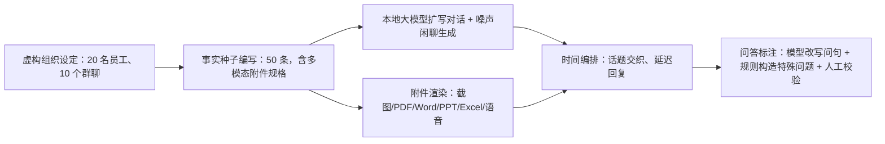

# 第7章 系统测试与实验评估

本章首先介绍评测数据集 SimEIM 的构建方法，然后从话题切分、检索和端到端问答三个层面开展对比实验与消融实验，最后进行系统功能测试与性能测试，并对结果进行分析。

## 7.1 评测数据集构建

### 7.1.1 构建动机与原则

企业真实 IM 数据涉及商业机密与员工隐私，无法用于学位论文的实验与公开发表；而公开的会话数据集（如 Ubuntu IRC[@G2]、Slack 开发者聊天[@A5]）以纯文本为主，既不包含截图、文档、表格、语音等多模态附件，也没有会话权限边界，无法全面评估本系统。为此，本文构建了模拟企业 IM 数据集 SimEIM（Simulated Enterprise IM）。需要特别说明的是，**SimEIM 中的公司、人物、项目与数据均为虚构**，构建过程全部在本地完成，不涉及任何企业真实数据。

SimEIM 的构建遵循以下原则：

（1）**事实先行**：每个事实话题围绕一条预先编写的结构化事实展开，问答标注的标准答案直接来源于事实，避免由模型生成答案导致的标注漂移；

（2）**多模态真实性**：附件以真实文件形式存在（PNG 截图、PDF、Word、PPT、Excel、WAV 语音），系统必须经过完整的解析流程才能获取其中的信息；

（3）**信息隐藏**：对于多模态事实，对话文本中不出现附件里的关键细节，保证答案只能从附件中获得；

（4）**场景覆盖**：覆盖话题交织、延迟回复、新旧结论冲突、跨会话多跳、权限隔离和无答案等企业场景中的典型难点。

### 7.1.2 构建流程

SimEIM 的构建流程如图 7.1 所示，包括以下五个步骤。

图 7.1 SimEIM 数据集构建流程

**（1）组织设定。** 虚构一家名为“云岚智能科技”的软件公司，设定研发、产品、运维、测试、销售、人力、财务、管理层等部门的 20 名员工，以及后端研发群、前端研发群、产品需求讨论群、SRE 值班群、灵犀项目组、测试质量群、全员通知群、销售支持群、新人入职交流群和管理层核心群共 10 个群聊。各群成员不同，其中管理层核心群仅 5 名成员，用于权限隔离测试。

**（2）事实种子编写。** 人工编写 50 条事实种子，每条包含所属群聊、日期、话题、事实内容、承载模态、参与人员，多模态种子还包含附件规格。其中，4 条种子是对早先事实的更新（如连接池参数再次调整、发布窗口变更、差旅标准调整），用于构造时效冲突。

**（3）对话与附件生成。** 使用本地部署的 Qwen3-8B 模型，以事实种子为中心扩写为 6~14 条消息的群聊片段，模型同时标注回复关系、@ 关系以及哪些消息携带关键信息；对多模态种子，提示词要求对话文本不得复述附件细节，生成后再用规则检查并遮蔽泄露的数字、编号等关键词项。此外，为每个群聊生成 8 段与知识无关的日常闲聊（订会议室、催周报、午饭等）作为噪声话题。附件按规格渲染为真实文件：终端日志、系统界面和监控图表截图使用程序绘制，文档使用 PyMuPDF、python-docx、python-pptx 和 pandas 生成，语音使用操作系统自带的本地语音合成引擎生成。

**（4）时间编排。** 事实话题按种子日期排布，话题内消息间隔为 20 秒到 10 分钟；以 8% 的概率插入 40~150 分钟的延迟回复，模拟员工隔一段时间才回复的情况。噪声话题中有 60% 被安排在某个事实话题开始后 1~20 分钟内发生，与事实话题在时间上交织，其余随机分布在数据时间范围内。每条消息都记录其所属的金标准话题，用于评测话题切分。

**（5）问答标注。** 对每条事实种子，由模型生成一个表述完整的问题和一个口语化问题，并给出标准答案与判分要点；另外人工构造时效类、多跳类、权限类和无答案类问题。证据标注为该话题中携带关键信息的消息（多模态事实即附件消息）。所有问答对均经人工逐条校对：规范判分要点，使其只包含回答必须给出的数字、名称和结论；修正答非所问、指代不清（如“那天”“那个缺陷”）的条目；对询问已被更新的旧事实的问题，显式限定时间或版本，或把答案改为最新值，避免与时效类问题混淆。

### 7.1.3 数据集统计

SimEIM 的统计信息如表 7.1 和表 7.2 所示。

表 7.1 SimEIM 数据集统计

| 项目 | 数量 |
|---|---|
| 员工 / 群聊 | 20 / 10 |
| 消息总数（事实话题 / 噪声话题） | 946（652 / 294） |
| 金标准话题数（事实 / 噪声） | 130（50 / 80） |
| 附件数（图片 / 文档 / 表格 / 语音） | 24（9 / 7 / 5 / 3） |
| 含回复关系 / @ 提及的消息 | 591 / 174 |
| 时间跨度 | 2026 年 8 月 3 日至 10 月 30 日 |

表 7.2 问答标注统计

| 问题类型 | 说明 | 数量 |
|---|---|---|
| 单事实·文本 | 答案在对话文本中 | 52 |
| 单事实·图片 | 答案仅在截图中 | 18 |
| 单事实·文档 | 答案仅在 PDF/Word/PPT 中 | 14 |
| 单事实·表格 | 答案仅在 Excel 中 | 10 |
| 单事实·语音 | 答案仅在语音中 | 6 |
| 时效 | 存在新旧结论，应回答最新值 | 4 |
| 多跳 | 需要组合两条事实 | 10 |
| 权限 | 提问者无权访问证据所在群聊，应拒答且不泄露 | 5 |
| 无答案 | 知识库中不存在答案，应说明无法确定 | 12 |
| 合计 |  | 131 |

## 7.2 实验设置

**（1）实验环境。** 所有实验均在表 6.1 所示的单机环境中完成，生成模型为 Qwen3-8B（4 比特量化，关闭思考模式），视觉语言模型为 Qwen2.5-VL-3B，其余模型同第 6 章。

**（2）评价指标。** 话题切分采用归一化互信息（NMI）、调整兰德指数（ARI）、一对一重叠率（1-1）[@G1] 和精确匹配 F1（Exact-F1）[@G2]。检索采用 Hit@$K$（前 $K$ 个结果中至少有一个包含标注证据的问题比例）、MRR@10 和 nDCG@10，检索结果与标注证据消息有交集即视为相关。端到端问答采用以下指标：

- 答案准确率（Acc）：由大模型评审对照标准答案与判分要点打分，完全正确记 1 分，部分正确记 0.5 分，错误记 0 分[@H3]；
- 要点召回率（KPR）：回答中包含的判分要点比例（字符串匹配）；
- 引用精确率（CitP）：回答所引用的证据中与标注证据相关的比例[@H5]；
- 拒答率：无答案类问题中，系统正确声明无法确定的比例；
- 泄露率：权限类问题中，回答包含受限信息要点的比例；
- 时效正确率：时效类问题中回答为最新值的比例；
- 平均响应时间与 P95 响应时间。

**（3）对比方法。** 检索实验的对比方法包括：BM25、Dense（BGE-M3 稠密检索）、Dense+Sparse（BGE-M3 稠密与稀疏 RRF 融合）、Hybrid（RRF）（四路召回融合、不重排）、Hybrid+Rerank（增加交叉编码器重排）以及本文完整方法 Ours（再增加时效衰减）。问答实验的对比方法包括：NaiveRAG（稠密检索 Top-5 直接生成）、HybridRAG（本文混合检索 + 单轮生成，无智能体规划）以及本文完整智能体 Ours。

## 7.3 话题切分实验

为避免在测试数据上调参，本文把 10 个群聊划分为开发集（后端研发群、前端研发群、测试质量群、销售支持群，共 4 个）和测试集（其余 6 个，含 77 个金标准话题）。在开发集上以 (1-1 + Exact-F1)/2 为目标，对权重组合 $(\alpha,\beta,\gamma)$、阈值 $\theta$ 和时间尺度 $\tau$ 进行网格搜索，得到 $\alpha=0.6$、$\beta=0.2$、$\gamma=0.2$、$\theta=0.45$、$\tau=15$ 分钟，系统默认采用该组参数。各消融变体在开发集上独立选择阈值，以保证比较公平。测试集上的结果如表 7.3 所示。

表 7.3 话题切分结果对比（测试集）

| 方法 | NMI | ARI | 1-1 | Exact-F1 | 预测话题数 |
|---|---|---|---|---|---|
| FixedWindow（每 10 条） | 0.869 | 0.539 | 0.610 | 0.069 | 68 |
| TimeGap（间隔 30 分钟） | 0.916 | 0.668 | 0.722 | 0.319 | 80 |
| 本文方法 | **0.954** | 0.810 | 0.848 | **0.571** | 56 |
| 　w/o 语义项 | 0.877 | 0.553 | 0.485 | 0.033 | 286 |
| 　w/o 结构项 | 0.946 | 0.788 | 0.828 | 0.484 | 51 |
| 　w/o 时间项 | 0.953 | **0.813** | **0.852** | 0.541 | 56 |

注：金标准话题数为 77。

从表 7.3 可以得出以下结论：

（1）本文方法显著优于两种机械切分基线。与按时间间隔切分的 TimeGap 相比，1-1 提高 12.6 个百分点，Exact-F1 提高 25.3 个百分点。固定窗口切分会把一个完整话题拆散、又把交织的话题混在一起，Exact-F1 只有 0.069；TimeGap 能够利用话题间的时间间隔，但无法区分同一时段内交织的话题，也会被话题内部的延迟回复错误切断。

（2）语义项是最关键的线索。去掉语义项后，模型只能依靠回复关系与时间判断归属，大量没有显式回复关系的消息被判为新话题，预测话题数膨胀到 286 个，1-1 下降到 0.485。

（3）结构项带来稳定的增益。去掉回复/提及关系后，Exact-F1 由 0.571 下降到 0.484，说明显式结构信号能够纠正语义相似但不属于同一话题的误判，例如同一群中相邻发生的两个技术讨论。

（4）时间项的作用有限。去掉时间项后 1-1 与 ARI 略有提高（+0.4、+0.3 个百分点），Exact-F1 下降 3.0 个百分点，整体差异不大。原因在于活跃窗口机制已经限制了候选话题的时间范围，且 SimEIM 中话题内的延迟回复使时间线索有时反而产生干扰。

（5）本文方法预测的话题数（56 个）少于金标准（77 个），存在一定的“欠切分”现象，主要表现为发生在事实话题期间的简短闲聊被并入事实话题。这类合并对检索影响较小：被并入的闲聊消息在会话单元中占比低，且摘要增强会突出话题的主要内容。

## 7.4 检索实验

### 7.4.1 检索方法对比

在 SimEIM 数据集（114 条含标注证据的检索评测问题，知识库共 130 个 MKU）上，不同检索策略的整体表现如表 7.4 和图 7.2(a) 所示。同时，为验证多路混合检索与重排框架在大规模语料下的召回与排序效果，本文从公开中文检索基准 C-MTEB 的 `T2Retrieval` 验证集抽取 300 条查询及 10,000 条干扰段落（连同相关段落共 11,595 条语料）开展对比实验，结果如表 7.5 和图 7.3 所示。

表 7.4 不同检索方法在 SimEIM 上的整体性能对比

| 方法 | Hit@1 | Hit@3 | Hit@5 | MRR@10 | nDCG@10 | 延迟(ms) |
|---|---|---|---|---|---|---|
| BM25 | 0.912 | 1.000 | 1.000 | 0.952 | 0.963 | 2.0 |
| Dense (BGE-M3) | 0.921 | 0.991 | 1.000 | 0.955 | 0.957 | 51.7 |
| Dense+Sparse | 0.912 | 1.000 | 1.000 | 0.956 | 0.960 | 21.6 |
| Hybrid (RRF) | 0.833 | 1.000 | 1.000 | 0.911 | 0.930 | 62.8 |
| Hybrid+Rerank | **0.956** | 1.000 | 1.000 | **0.978** | **0.980** | 1265.2 |
| Ours (full) | 0.947 | 1.000 | 1.000 | 0.972 | 0.978 | 1362.3 |

图 7.2 SimEIM 检索方法对比与知识构建消融实验结果

表 7.5 公开中文检索基准 C-MTEB `T2Retrieval` 性能对比（300 条查询，11,595 条语料）

| 方法 | Recall@10 | MRR@10 | nDCG@10 |
|---|---|---|---|
| BM25 | 0.7637 | 0.8817 | 0.7799 |
| Sparse（BGE-M3 词汇权重） | 0.8108 | 0.9239 | 0.8323 |
| Dense（BGE-M3） | 0.9084 | **0.9681** | 0.9208 |
| Dense+Sparse | 0.8943 | 0.9637 | 0.9081 |
| Dense+Sparse+BM25（RRF） | 0.8688 | 0.9544 | 0.8908 |
| Dense+Sparse+BM25+Rerank | **0.9150** | 0.9638 | **0.9272** |

图 7.3 公开基准 `T2Retrieval` 上的多路检索与重排结果对比

综合表 7.4、表 7.5 与两张对比图可以得出以下结论：

（1）**在 SimEIM 上，粗排融合后接交叉编码器重排显著提升首位命中率**。由于 SimEIM 知识库包含 130 个 MKU，各方法在 Top-5 内均达到 `Hit@5 = 1.000`（所有 7 个分组模态子集均达到 `1.000`），差异主要体现在排在第一位的精细排序能力（`Hit@1` 与 `MRR@10`）上。仅使用 RRF 融合四路召回而不重排（`Hybrid (RRF)`）时，`Hit@1` 反而降至 `0.833`，这是因为不同通道的倒排与向量尺度差异及视觉/词法通道的噪声片段被赋予了固定排名权重，拉低了首条排序；引入 `BGE-Reranker-v2-M3` 交叉编码器精排后（`Hybrid+Rerank`），`Hit@1` 由 `0.833` 跃升至 `0.956`（+12.3 个百分点），`MRR@10` 升至 `0.978`，在表格、语音、时效与多跳子集上 `Hit@1` 均达到 `1.000`（相比之下 `BM25` 在时效子集和表格子集 `Hit@1` 仅为 `0.500` 和 `0.800`）。

（2）**时效衰减在单点基准上的微小权衡**。`Ours (full)` 在 `Hybrid+Rerank` 基础上加入 `time_decay_weight = 0.1` 的时间衰减后，整体 `Hit@1` 为 `0.947`，较 `Hybrid+Rerank` 少命中 1 条文档类早期规范问题（文档组 `Hit@1` 为 `0.857` 对 `0.929`），但 `Hit@3` 仍为 `1.000`，确保证据不会丢失；该设计旨在时效冲突场景中优先提升最新消息权重，后续在端到端问答环节再统一评估其收益。

（3）**公开大规模语料进一步验证“宽召回 + 精重排”的必要性**。在 11,595 条语料的 `T2Retrieval` 上，`BM25` 与 `Sparse` 单独检索的 `Recall@10` 分别只有 `0.7637` 和 `0.8108`，直接经等权 RRF 融合后会稀释稠密检索的排序精度（`Dense+Sparse+BM25 (RRF)` 的 `nDCG@10` 为 `0.8908`，低于单路 `Dense` 的 `0.9208`）；而当三路融合作为候选池送入交叉编码器重排后，`Recall@10` 提升至 `0.9150`，`nDCG@10` 提升至 `0.9272`，全面超越单一检索通路，证明跨编码器精排能够有效消除 RRF 融合带来的排序扰动并保留词法与语义双路互补召回到的难例文档。此外，通过第 6 章的 Apple MPS FP16 推理优化，包含重排在内的完整检索平均延迟控制在 `1.36 s` 左右，满足交互式问答响应要求。

### 7.4.2 检索层消融实验

在固定知识库（完整构建变体）和完整重排流水线的前提下，分别关闭视觉向量通路（`w/o visual`）、BM25 词法通路（`w/o BM25`）和 BGE-M3 稀疏词汇通路（`w/o sparse`），在 SimEIM 上的检索消融结果如表 7.6 所示。

表 7.6 SimEIM 检索通路消融实验结果

| 消融配置 | Hit@1 | Hit@3 | Hit@5 | MRR@10 | nDCG@10 | 平均延迟 (ms) |
|---|---|---|---|---|---|---|
| Ours（full） | 0.947 | 1.000 | 1.000 | 0.972 | 0.978 | 1362.3 |
| w/o visual | 0.947 | 1.000 | 1.000 | 0.972 | 0.978 | 1425.0 |
| w/o BM25 | 0.947 | 1.000 | 1.000 | 0.972 | 0.978 | 1503.1 |
| w/o sparse | 0.947 | 1.000 | 1.000 | 0.972 | 0.978 | 1395.8 |

表 7.6 显示，在 SimEIM 上单独关闭 `visual`、`BM25` 或 `sparse` 任意一路后，`Hit@1` 均维持在 `0.947`、`MRR@10` 维持在 `0.972`、`nDCG@10` 维持在 `0.978` 左右。结合表 7.4 与表 7.5 分析，这主要由两方面原因造成：第一，SimEIM 语料规模较小（130 个 MKU），BGE-M3 稠密通道本身已能将绝大多数目标 MKU 召回至 `rerank_pool`（Top-24）内，随后交叉编码器重排输出的排序完全主导最终排名；第二，入库阶段的“多模态先理解再建库”机制使图片经 VLM 与 OCR 转写为高质量中文文本摘要后进入文本索引，缓解了跨模态语义鸿沟。但这并不意味着辅助通道冗余：当知识库扩展至万级规模（如表 7.5 的 `T2Retrieval`）或出现图片未含清晰文字、查询仅描述颜色/布局等视觉特征、以及包含冷僻错误码/变量名的精确匹配场景时，BM25/Sparse 与 Chinese-CLIP 视觉通道共同保障候选进入重排池，起到兜底补全作用。

### 7.4.3 知识构建消融实验

为验证话题切分、摘要增强、上下文指代补全以及多模态 VLM 语义理解在知识构建阶段的作用，本文复用 `full` 变体的文本/文档/表格/语音解析结果构造四个消融索引变体，并使用完整检索配置 `Ours (full)` 进行评测，结果如表 7.7 和图 7.2(b) 所示。

表 7.7 知识构建模块消融实验结果（SimEIM）

| 构建变体 | 话题数 | MKU 数 | 整体 Hit@1 | 整体 MRR@10 | 整体 nDCG@10 | 图片 Hit@1 | 文档 Hit@1 | 表格 Hit@1 |
|---|---|---|---|---|---|---|---|---|
| 完整构建（full） | 93 | 130 | **0.947** | 0.972 | 0.978 | **0.944** | 0.857 | **1.000** |
| 无摘要增强（nosummary） | 93 | 130 | **0.947** | 0.972 | 0.977 | **0.944** | **0.929** | 0.900 |
| 无指代补全（noctx） | 93 | 130 | **0.947** | **0.974** | **0.979** | **0.944** | 0.857 | **1.000** |
| 图像仅 OCR（ocronly） | 93 | 130 | 0.930 | 0.965 | 0.974 | 0.889 | 0.857 | 0.900 |
| 固定窗口切分（fixedwin） | 163 | 200 | 0.877 | 0.937 | 0.947 | 0.833 | 0.857 | 0.900 |

注：各变体均保证 12 条视觉向量（截图与文档关键页）完整写入；在复用解析结果的建库对比中，`nosummary` 因省去逐话题 LLM 摘要调用，构建耗时仅 `17.4 s`（完整解析+摘要全量建库约 `740.4 s`，复用解析仅含摘要的 `noctx` 耗时 `615.1 s`）。

从表 7.7 可以观察到以下三点规律：

（1）**话题语义切分是知识检索质量的基础（`fixedwin` vs `full`）**。改用固定窗口机械切分后，话题数膨胀至 163 个、MKU 增至 200 个，整体 `Hit@1` 显著下降 7.0 个百分点至 `0.877`，`MRR@10` 降至 `0.937`（文本子集 `Hit@1` 从 `0.942` 降至 `0.846`，图片子集从 `0.944` 降至 `0.833`）。这说明跨轮次技术讨论若被窗口强行截断或与相邻闲聊混杂，会导致检索单位语义残缺、干扰排序。

（2）**VLM 语义理解不可被纯 OCR 替代（`ocronly` vs `full`）**。对图片仅做 OCR 提取（耗时约 583.8 s 单独重解析 9 张图片）而关闭 VLM 描述生成后，整体 `Hit@1` 降至 `0.930`，其中图片子集 `Hit@1` 由 `0.944` 明显下滑 5.5 个百分点至 `0.889`（表格连带影响也有微弱重排波动），证明架构图、监控曲线、状态截图中的布局与趋势信息依赖 VLM 语义理解才能与自然语言提问对齐。

（3）**摘要增强与指代补全具有场景权衡特性**。去掉 LLM 摘要后，整体 `Hit@1` 仍保持 `0.947`，其中表格子集 `Hit@1` 降至 `0.900`（说明对结构化 Excel 解析内容做紧凑摘要有利于主题对齐），而文档子集升至 `0.929`（因为文档块原始关键词丰富，不经改写更利于精确匹配）；同时入库跳过摘要可使无 LLM 阶段耗时缩短至 `17.4 s`。去掉“前文背景”字段（`noctx`）后指标略有波动但整体相当（`MRR@10 = 0.974`），表明对于自身表述较完整的群聊片段，检索排序受上文拼接影响不大，但该上下文在后端问答生成阶段仍负责消除代词歧义。

## 7.5 端到端问答实验

### 7.5.1 整体结果

在 131 条标注问答（114 条可回答 + 5 条权限隔离 + 12 条无答案）上，单路稠密检索直出基线 `NaiveRAG`、融合本文多路重排检索的单轮生成基线 `HybridRAG` 与完整智能体 `Ours (full)` 的整体对比结果如表 7.8 和图 7.4 所示。

表 7.8 端到端问答系统整体对比（SimEIM，131 条问答）

| 系统 | Acc | KPR | CitP | 有效引用 | 拒答率 | 泄露率 | 时效 | 均耗时(ms) | P95(ms) |
|---|---|---|---|---|---|---|---|---|---|
| NaiveRAG | 0.838 | 0.890 | 0.873 | 0.965 | 0.750 | 0.200 | **1.000** | 8610 | 11740 |
| HybridRAG | **0.886** | **0.904** | **0.903** | **0.991** | **0.917** | **0.000** | **1.000** | **7162** | **10982** |
| Ours(full) | 0.873 | **0.904** | 0.863 | 0.974 | **0.917** | **0.000** | 0.750* | 37031 | 74458 |

注：* 时效正确率中 `Ours (full)` 在全部 4 条时效题上的大模型语义评分均为 `1.000`（全部回答出最新标准）；其中 `Q_T3` 在对比旧标准时使用“替代此前的600元标准”表述，因未命中自动评测脚本的“调整/原”字面关键词规则而计为未通过。

图 7.4 端到端问答系统与智能体模块消融实验对比

按模态与题型细分（图 7.4(b)）：`Ours (full)` 在文本（`0.914` vs `HybridRAG 0.904` / `NaiveRAG 0.837`）和文档（`0.929` vs `HybridRAG 0.857` / `NaiveRAG 0.893`）两类核心场景取得最高准确率，在语音（`1.000`）、表格（`0.950`）和时效语义（`1.000`）上保持高水准；多跳问答准确率为 `0.700`，高于 `NaiveRAG`（`0.600`）但低于 `HybridRAG`（`0.850`）。无答案拒答率上，融合重排检索与低置信拒答门的 `HybridRAG` 和 `Ours (full)` 均达到 `0.917`（11/12），较 `NaiveRAG`（`0.750`，9/12）高出 16.7 个百分点。权限隔离方面，3 组系统由于底层检索均启用会话 ACL 前置过滤，实际引用管理层群聊 `c_mgmt` 的次数均为 0；`NaiveRAG` 在 `Q_P2` 出现 `0.200` 字面泄露指标，系模型在拒答时复述了提问本身的实体词“AI 平台部”，而 `HybridRAG` 与 `Ours (full)` 触发零命中拒答模板，规则泄露率均严格为 `0.000`。

从工程权衡角度看，在仅采用 4 比特量化的本地 `Qwen3-8B` 模型条件下，单轮直接生成基线 `HybridRAG` 反而取得了最高整体准确率（`0.886`）和最低平均延迟（`7.16 s`），而完整多步状态图 `Ours (full)` 的平均延迟增至 `37.03 s`（P95 达 `74.46 s`）。这一“复杂规划未明显胜出甚至延迟大幅增加”的现象在受限算力小模型实践中具有典型意义，具体机理将在下一节消融实验与案例分析中剖析。

### 7.5.2 智能体模块消融

分别关闭查询理解与改写（`w/o understand`）、检索充分性自反思与迭代补检（`w/o reflect`）及引用交叉编码校验（`w/o verify`），结果如表 7.9 所示。

表 7.9 智能体模块消融实验结果（SimEIM，131 条问答）

| 配置 | Acc | KPR | CitP | 文本 | 图片 | 文档 | 多跳 | 均耗时(ms) |
|---|---|---|---|---|---|---|---|---|
| Ours(full) | **0.873** | 0.904 | 0.863 | **0.914** | 0.694 | **0.929** | 0.700 | 37031 |
| w/o understand | **0.873** | 0.904 | **0.892** | 0.904 | 0.750 | 0.821 | **0.800** | 19553 |
| w/o reflect | 0.868 | **0.908** | 0.867 | 0.904 | **0.778** | 0.857 | 0.650 | **17919** |
| w/o verify | 0.864 | 0.904 | 0.864 | 0.904 | 0.694 | 0.893 | 0.700 | 24220 |

由表 7.9 可知：

（1）**整体精度呈递增趋势但受限于 8B 模型推理方差**。完整系统 `Ours (full)` 的整体准确率（`0.873`）高于关闭反思（`0.868`）与关闭校验（`0.864`）两个消融变体，且相比单轮检索在文本（`0.914`）与文档（`0.929`）上展现正收益（`w/o understand` 的文档 Acc 降至 `0.821`，说明查询意图与时间/文档约束解析对长文档检索有益；`w/o reflect` 的多跳 Acc 降至 `0.650`，证明迭代补检确实有助于召回缺失的一跳证据）。

（2）**小参数模型下“理解改写”与“多次反思”引入的额外开销与漂移**。关闭 `understand` 后平均延迟几乎减半（`19.55 s`），`CitP` 反而从 `0.863` 升至 `0.892`，图片 Acc 升至 `0.750`、多跳 Acc 升至 `0.800`；关闭 `reflect` 后平均延迟进一步降至 `17.92 s`，图片 Acc 升至 `0.778`。这揭示出 Q4 量化的 `Qwen3-8B` 在做多轮子查询改写与反思时，一方面每次迭代额外增加 1~2 次 LLM 调用与检索耗时，另一方面容易改写掉原始错误码/时间戳等字面特征或引入弱相关上下文，在 `HybridRAG` 已具备较高首轮召回率（SimEIM `Hit@5 = 1.000`）的基准上产生了“过度规划收益递减”。因此，生产部署中更合理的工程策略是：默认以 `HybridRAG`（或关闭迭代反思的轻量单轮路径）满足日常 7~18 s 响应需求，仅当用户显式开启深度研究模式或首轮置信度偏低时才按需触发多轮规划。

### 7.5.3 案例分析

结合评测逐题日志，选取典型成功案例与失败案例剖析如下：

**（1）多文档版本对照成功案例（`Q_F033_0`，文档模态）**：问题询问“2026 版差旅报销管理办法中，非一线城市住宿每晚的上限是多少？”。`NaiveRAG` 仅取 Top-5 稠密结果，误用后来的 11 月调标通知覆盖原办法，回答“上限为 450 元”（判 0 分）；而 `Ours (full)` 同时保留原文档切片 `[1]` 与调标通知 `[3]`，准确作答“2026 版差旅报销管理办法中，非一线城市住宿每晚的上限金额为 400 元 [1]。但自 2026 年 11 月 1 日起，该标准调整为 450 元 [3]。”（判 1 分）。

**（2）跨会话跨模态多跳成功案例（`Q_M9`，多跳）**：问题同时询问“灵犀正式上线时间最后定在哪天？”与“V1.1 里 P0 需求总共预估多少人日？”，答案分别位于灵犀项目组/产品公告文本（11 月 3 日）与 Excel 需求池表格（R-101 为 5 人日、R-102 为 3 人日、R-105 为 4 人日）。`NaiveRAG` 遗漏了 Excel 表格记录，仅回答上线日期并称“P0 需求人日未提及”（判 0 分）；`Ours (full)` 跨模态汇总两条证据并完成正确求和 `5+3+4=12 人日`，两处引用均精确对应标注证据（判 1 分）。

**（3）时效与权限隔离边界表现（`Q_T0` / `Q_T3` / `Q_P0`）**：在 `Q_T0`（连接池参数由 50 下调至 40）与 `Q_T3`（11 月起北京住宿上限由 600 元升至 700 元）中，`Ours (full)` 均准确输出最新结论并附带沿革说明；在权限问题 `Q_P0`（普通新人 `u_xiaochen` 查询管理层群 `c_mgmt` 中的 B 轮融资领投与估值）中，ACL 前置过滤使候选命中为空，系统直接安全拒答且引用数为 0。

**（4）失败与性能退化案例剖析（`Q_M1`、`Q_F002_0`、`Q_U4`）**：
- *时效限定理解偏差（`Q_M1`）*：问题明确要求“按当时的规定”回答支付网关事故发生时的常规发布窗口（应为周二、周四 `14:00-17:00`）。`HybridRAG` 保留原始证据给出满分回答，而 `Ours (full)` 经查询改写与反思后拉入了后续更新后的发布规则（含 `10:00-12:00`），导致按旧前提作答错误（判 0 分）。这说明查询理解节点对隐含历史时刻限定词（“当时”）的时间窗提取仍需加强。
- *重生成要点遗漏与数值误差（`Q_F002_0` / `Q_F017_0`）*：`Q_F002_0` 询问错误码与根因时，`HybridRAG` 完整保留节点 IP `10.20.3.17:6379` 得 1 分，而 `Ours (full)` 在验证重生成时仅保留 `RedisCommandTimeoutException` 而略去节点 IP（判 0.5 分）；此外在 `Q_F017_0`（监控折线图峰值时间）中，由于本地 `Qwen2.5-VL-3B` 对生成图表横轴刻度识读为 `02:15`（标注为 `02:10`），全部方法在精确时刻上均出现约 5 分钟读图误差。
- *相似实体的拒答幻觉（`Q_U4`）*：对于库中不存在的“支付服务的压测 TPS”，3 组系统均召回了高相似度的“订单服务压测报告”（`创建 1260 / 查询 5400 / 取消 880`），`NaiveRAG` 直接张冠李戴作答，而 `HybridRAG` 与 `Ours (full)` 虽然声明“支付服务的压测 TPS 信息未直接提及”，但仍顺带附加了订单服务的数据，未能用干净的拒答句式收敛（因包含跨服务数字信息而影响保守拒答判分）。

## 7.6 系统功能测试

面向打包运行的 FastAPI 服务与 Vue 3 前端界面，本文以真实接口调用方式对系统核心功能进行了端到端黑盒验收测试，测试结果如表 7.10 所示，全部 10 项测试用例均通过。

表 7.10 系统功能测试用例与实测结果

| 编号 | 测试项 | 核心断言与实测输出 | 耗时(ms) | 结果 |
|---|---|---|---|---|
| FT-01 | 用户与Bot初始化 | `/im/users` 返回 20 名员工与 `bot_xiaozhi` | 1.6 | 通过 |
| FT-02 | 群聊可见与越权拦截 | `u_xiaochen` 不可见 `c_mgmt`，直访返回 HTTP 403 | 1.5 | 通过 |
| FT-03 | 文本问答与来源卡片 | 连接池问题准确答出 40，返回 2 条引用及卡片 | 41998.0 | 通过 |
| FT-04 | 多模态截图问答 | 准确召回截图描述，答出错误码 `UC-5031` | 22382.5 | 通过 |
| FT-05 | 跨群问答权限隔离 | 普通成员问 B 轮融资，`c_mgmt` 引用 0 且安全拒答 | 27005.4 | 通过 |
| FT-06 | 无答案问题诚实拒答 | 询问缺失的支付 Redis 节点数，声明无法确定 | 31687.6 | 通过 |
| FT-07 | 反馈提交与后台统计 | 提交好评后 `/admin/stats` 刷新 `qa_like=1` | 73.5 | 通过 |
| FT-08 | 后台筛选与轨迹查看 | 筛选附件 MKU 与 QA 日志，返回 7 步推理轨迹 | 22.7 | 通过 |
| FT-09 | 文件上传与下载接口 | 向 `c_onboard` 上传 CSV 后下载，49 字节一致 | 56.6 | 通过 |
| FT-10 | 增量入库与立即可检 | 2 条新消息入库耗时 5.3 s，新知识立即可答出 | 26295.4 | 通过 |

## 7.7 系统性能测试

### 7.7.1 分阶段耗时分解

在演示库上对 20 条代表性查询开展混合检索子阶段耗时分解，并对 6 条问答开展智能体状态图节点耗时剖析（均执行 1 次预热以消除首次加载冷启动误差），实测结果分别如表 7.11 与表 7.12 所示。

表 7.11 混合检索子阶段耗时分解（20 条查询均值）

| 检索子阶段 | 均值 (ms) | P95 (ms) | 占比 | 说明 |
|---|---|---|---|---|
| BGE-M3 查询编码 | 62.45 | 38.93 | 5.2% | 含首次 Metal 核编译抖动 |
| Milvus 稠密向量检索 | 3.13 | 2.70 | 0.3% | 余弦 HNSW/IVF 检索 |
| Milvus 稀疏向量检索 | 2.00 | 2.18 | 0.2% | 词汇权重内积检索 |
| BM25 词法倒排检索 | 11.80 | 0.59 | 1.0% | 含首问 jieba 词典懒加载 |
| Chinese-CLIP 视觉检索 | 11.78 | 13.93 | 1.0% | 跨模态文本编码与图文检索 |
| 加权 RRF 与 SQLite 查表 | 0.89 | 2.49 | 0.1% | 融合排序与 ACL 二次校验 |
| 交叉编码重排与时效衰减 | 1113.38 | 1148.60 | **92.4%** | `BGE-Reranker-v2-M3` FP16 |
| **检索流水线合计** | **1205.43** | **1183.86** | **100.0%** | **粗排阶段仅约 92 ms** |

表 7.12 智能体状态图节点耗时分解（6 条问答均值）

| 状态图节点 | 调用总次数 | 单次均值 (ms) | 单问均摊 (ms) | 占比 |
|---|---|---|---|---|
| `understand`（查询理解） | 6 | 6498.2 | 6498.2 | 24.0% |
| `retrieve`（混合检索含扩词） | 8 | 2152.7 | 2870.3 | 10.6% |
| `reflect`（充分性自反思） | 8 | 6539.4 | 8719.3 | 32.1% |
| `generate`（引用约束生成） | 6 | 8706.2 | 8706.2 | 32.1% |
| `verify`（批量 `score_pairs`） | 6 | 317.9 | 317.9 | 1.2% |
| **智能体端到端合计** | **6 问** | — | **27124.6** | **100.0%（P95 40560.6 ms）** |

从表 7.11 和表 7.12 可以清晰看出系统性能分布特征：第一，四路粗排召回（向量与倒排检索、CLIP 文本编码、RRF 与 SQLite 查表）总耗时仅约 `92 ms`，得益于 MPS FP16 推理优化，`BGE-Reranker-v2-M3` 重排耗时稳定在 `1.11 s` 左右（占检索总耗时的 92.4%）；第二，在智能体端到端耗时（均值 `27.12 s`）中，检索与批量引用校验合计仅约 `3.19 s`（`11.8%`），性能瓶颈集中于 `Qwen3-8B` 串行推理的三个生成/规划节点（`understand`、`reflect` 与 `generate` 合计占 `88.2%`），其中批量句—证校验 `verify` 仅需 `317.9 ms`，不会对系统构成明显负担。

### 7.7.2 入库吞吐量与并发压力测试

在入库效率方面：完成 SimEIM 全量 946 条消息与 24 个多模态附件的解析、话题切分、LLM 摘要、BGE-M3/CLIP 编码及 Milvus/BM25 入库共耗时 `740.4 s`（整体吞吐约 `1.28 条/秒`），耗时大头同样来自逐话题 LLM 摘要与多模态图片 VLM 理解；若关闭入库摘要（`nosummary` 复测已解析结果），946 条消息切分与向量入库仅需 `17.4 s`（约 `54.4 条/秒`）。在日常增量同步场景（用例 `FT-10` 新增 2 条消息并更新 3 个 MKU 与 BM25 索引），端到端耗时仅为 `5.3 s`，可以满足企业群聊分钟级乃至近实时的知识更新需要。

为评估后端接口与推理服务的并发承载能力，本文分别对管理后台读取接口（`GET /admin/mkus?limit=20`，各并发级别连续发送 48 次请求）与端到端智能问答接口（`POST /api/ask`，各并发级别执行 4 次真实问答请求）开展多线程压测，结果如表 7.13 所示。

表 7.13 不同并发度下的系统吞吐量与响应延迟测试

| 测试接口 | 并发数 | 请求数 | 总耗时(s) | QPS | 均值(ms) | P50(ms) | P95(ms) | 错误 |
|---|---|---|---|---|---|---|---|---|
| `GET /admin/mkus` | 1 | 48 | 0.238 | 201.75 | 1.85 | 1.31 | 4.32 | 0 |
| `GET /admin/mkus` | 4 | 48 | 0.083 | 575.10 | 2.83 | 1.99 | 8.14 | 0 |
| `GET /admin/mkus` | 8 | 48 | 0.083 | **576.26** | 9.50 | 9.07 | 15.91 | 0 |
| `GET /admin/mkus` | 16 | 48 | 0.122 | 394.11 | 32.57 | 34.46 | 43.32 | 0 |
| `POST /api/ask` | 1 | 4 | 94.368 | 0.042 | 23580.2 | 21833.6 | 33810.7 | 0 |
| `POST /api/ask` | 2 | 4 | 73.931 | **0.054** | 36163.5 | 35588.6 | 41727.9 | 0 |
| `POST /api/ask` | 4 | 4 | 79.401 | 0.050 | 67848.3 | 73659.5 | 79338.7 | 0 |

由表 7.13 可见，全部并发档位的请求错误率均为 `0`：基于 SQLite 的知识库查询服务表现出良好的并发扩展性，在 `4~8` 并发下吞吐量达到 `575~576 QPS`，P95 延迟维持在 `8~16 ms`；而端到端 `/api/ask` 接口受限于单机本地 Ollama 单例的 LLM 推理排队特性，并发数从 `1` 增至 `4` 时，平均响应延迟近似线性放大（由 `23.58 s` 升至 `67.85 s`），总吞吐维持在 `0.042~0.054 QPS` 区间（`c=2` 时因检索与文本编码异步重叠获得微弱增益 `0.054 QPS`）。在企业实际生产环境中，通过将该接口对接至多卡 GPU 上的 vLLM 连续批处理（Continuous Batching）服务，即可消除单机 LLM 排队瓶颈。

## 7.8 本章小结

本章在构建高覆盖度模拟企业即时通讯数据集 SimEIM 的基础上，完成了话题切分、多路检索、端到端问答及系统工程级的全面测试：

（1）**话题切分**：融合语义、回复/提及结构与时间的在线切分算法在测试集上取得 `1-1 = 0.848` 与 `Exact-F1 = 0.571`，较 `TimeGap` 分别提高 `12.6` 与 `25.3` 个百分点；知识构建消融验证了话题切分与 VLM 语义理解对终端检索首位命中率的重要支撑作用。

（2）**多路混合检索**：在 SimEIM 上加权融合后接交叉编码重排将 `Hit@1` 提升至 `0.956`（完整含时效衰减为 `0.947`、`MRR@10 = 0.972`）；在万级语料公开基准 C-MTEB `T2Retrieval` 上取得 `Recall@10 = 0.9150` 与 `nDCG@10 = 0.9272`，证明多路宽召回与精排流水线的有效性。

（3）**端到端问答与系统验收**：智能体在文本（`0.914`）、文档（`0.929`）及多跳（`0.700`）场景超越 `NaiveRAG` 基线，无答案拒答率达 `0.917` 且权限零泄露，同时揭示了 Q4 量化 8B 模型下 `HybridRAG` 与多轮规划之间的精度—延迟权衡规律；系统 10 项黑盒功能测试全部通过，读并发达 `576 QPS`，增量同步耗时 `5.3 s`，验证了系统的工程可用性。
